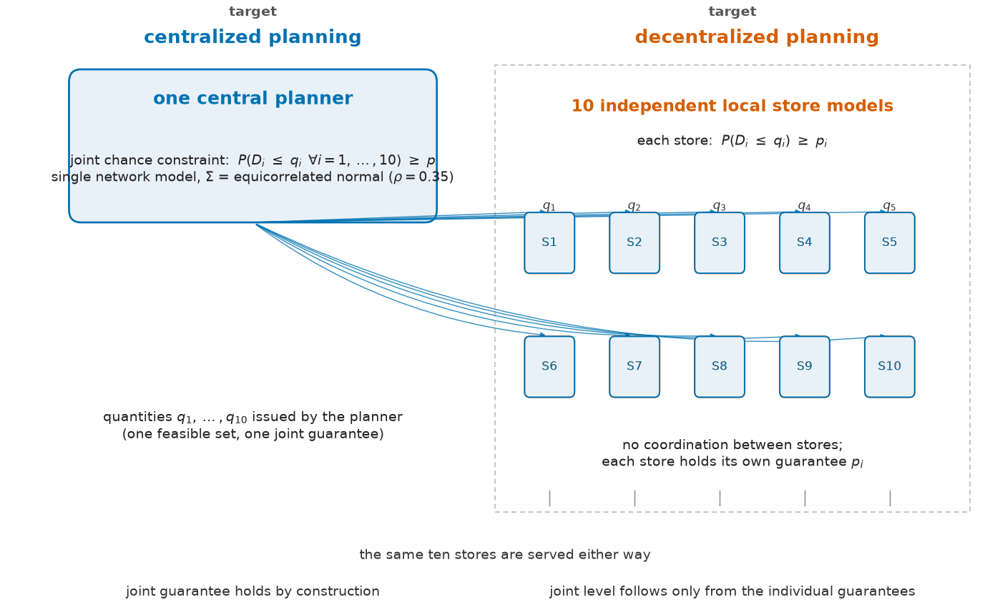
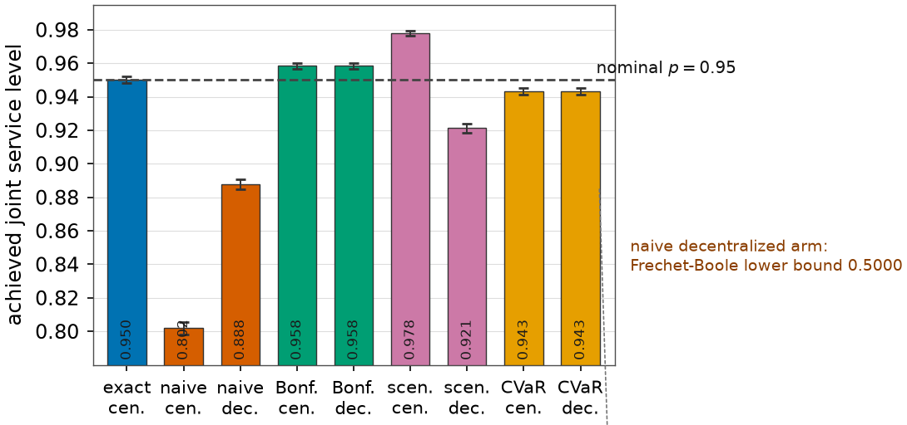
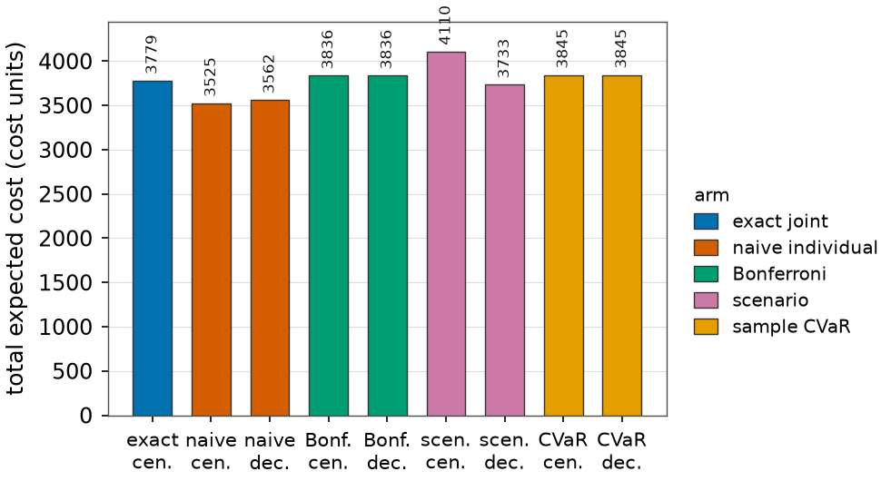
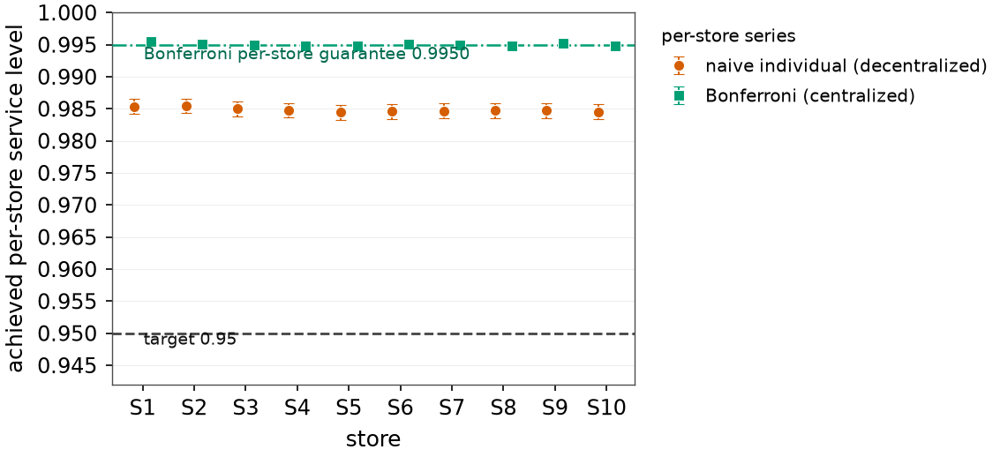
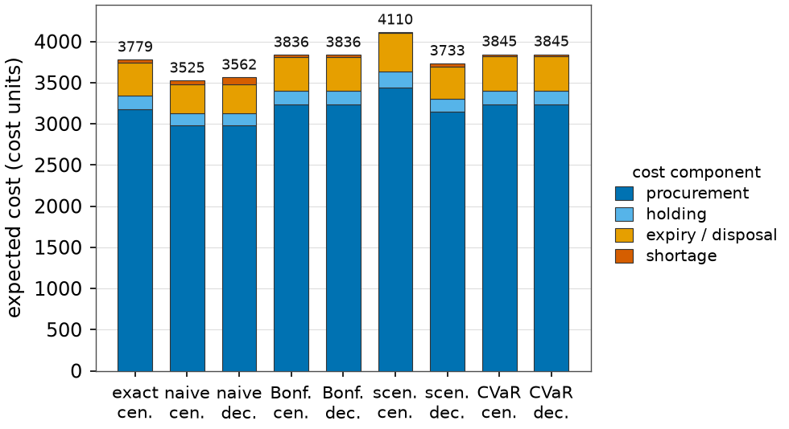
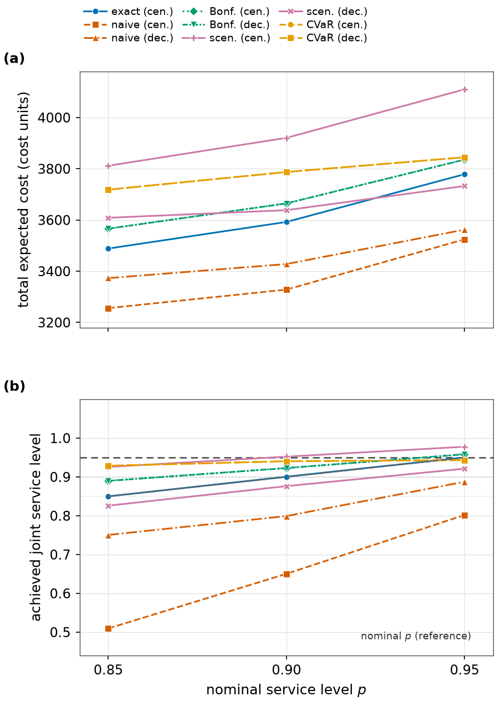
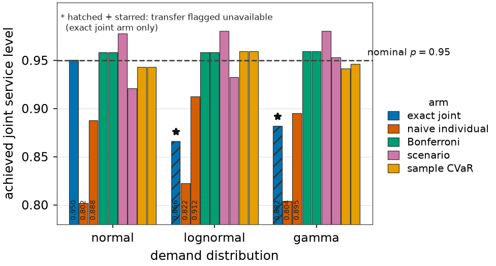

# main

**Technische Universität München** Chair of Management of Digital Food Businesses

# Expressing uncertainty using joint vs.

# individual probabilistic (chance) constraints on demand – a comparative study on centralized and

# decentralized planning

### Bachelor’s thesis (project study report)

**Author:** [Full name] **Matriculation number:** [Student ID] **Supervisor:** Prof. Dr. Marjolein Buisman **Chair:** Management of Digital Food Businesses **University:** Technische Universität München **Date:** [Month Year]

Submitted in partial fulfilment of the requirements for the degree of a Bachelor of Science,

in accordance with the thesis guidelines of the Chair of Management of Digital Food

Businesses.

<!-- Page 2 -->

## Signature Page

The undersigned confirm that this thesis was prepared under the supervision of the chair and has not been submitted elsewhere.

Prof. Dr. Marjolein Buisman [Second examiner] (Supervisor) (Examiner) Place, date Place, date

i

<!-- Page 3 -->

## Abstract

*This thesis compares two ways of expressing demand uncertainty in planning:* *joint* *chance constraints, which guarantee that all stores of a network are supplied simul-* *taneously* *with* *a* *prescribed* *probability,* *and* *individual* *chance* *constraints,* *which* *guarantee* *a* *service* *level* *only* *for* *each* *store* *separately.* *A* *new-product* *launch* *in* *ten* *retail* *stores* *with* *perishability* *and* *four* *cost* *components* *is* *formulated* *and* *solved* *with* *Gurobi,* *implementing* *five* *approximation* *methods* *from* *the* *literature* *under* *centralized* *and* *decentralized* *planning.* *Out-of-sample* *Monte* *Carlo* *evalu-* *ation* *shows* *that* *per-store* *guarantees* *of* *0.95* *leave* *the* *system-level* *service* *level* *unprotected,* *while* *a* *Bonferroni* *failure-budget* *split* *restores* *the* *system* *guarantee* *at* *moderate* *cost,* *the* *scenario* *approach* *at* *higher* *cost,* *and* *sample* *conditional* *value-at-risk only to a finite-sample bound.* *With identical service rows, centraliza-* *tion lowers cost.* *The exact multivariate-normal reformulation does not transfer to* *lognormal or gamma demand; all approximation schemes do.*

ii

<!-- Page 4 -->

## Table of Contents

**1** **Introduction** **1** 1.1 Motivation and problem setting . . . . . . . . . . . . . . . . . . . .

1 1.2 Problem statement and objectives . . . . . . . . . . . . . . . . . . .

2 1.3 Research questions . . . . . . . . . . . . . . . . . . . . . . . . . .

2 1.4 Approach and contribution . . . . . . . . . . . . . . . . . . . . . .

3 1.5 Scope and assumptions . . . . . . . . . . . . . . . . . . . . . . . .

3 1.6 Structure of the thesis . . . . . . . . . . . . . . . . . . . . . . . . .

3 **2** **Literature Review** **5** 2.1 Foundations of chance-constrained programming . . . . . . . . . .

5 2.2 Joint versus individual chance constraints . . . . . . . . . . . . . .

6 2.3 Tractability . . . . . . . . . . . . . . . . . . . . . . . . . . . . . .

7 2.4 Approximation methods . . . . . . . . . . . . . . . . . . . . . . .

8 2.4.1 Bonferroni and Boole-based allocation . . . . . . . . . . .

8 2.4.2 The scenario approach . . . . . . . . . . . . . . . . . . . .

8 2.4.3 Conditional value-at-risk surrogates . . . . . . . . . . . . .

8 2.4.4 Exact joint reformulation for Gaussian demand . . . . . . .

9 2.4.5 Point-based and marginal/bivariate relaxations . . . . . . .

9 2.5 Chance constraints in inventory planning . . . . . . . . . . . . . . .

9 2.6 Centralized versus decentralized planning . . . . . . . . . . . . . .

10 2.7 Synthesis and research gap . . . . . . . . . . . . . . . . . . . . . .

10 **3** **Methodology** **11** 3.1 Planning problem . . . . . . . . . . . . . . . . . . . . . . . . . . .

11 3.2 Deterministic base model . . . . . . . . . . . . . . . . . . . . . . .

11 3.3 Chance-constraint formulations . . . . . . . . . . . . . . . . . . . .

13 3.4 The five arms as deterministic equivalents . . . . . . . . . . . . . .

14 3.4.1 Naive individual and Bonferroni arms . . . . . . . . . . . .

14 3.4.2 Scenario arm . . . . . . . . . . . . . . . . . . . . . . . . .

15 3.4.3 Sample CVaR arm . . . . . . . . . . . . . . . . . . . . . .

15 3.4.4 Exact joint arm . . . . . . . . . . . . . . . . . . . . . . . .

15 3.5 Centralized and decentralized implementation . . . . . . . . . . . .

16 3.6 Extension to other demand distributions . . . . . . . . . . . . . . .

17

3.7

Experimental protocol

. . . . . . . . . . . . . . . . . . . . . . . .

19

**4**

**Results**

**21**

4.1

Binding mechanisms . . . . . . . . . . . . . . . . . . . . . . . . .

21

4.2

Main comparison at the headline level . . . . . . . . . . . . . . . .

21

iii

<!-- Page 5 -->

4.3 What individual guarantees deliver at the system level . . . . . . . .

24 4.4 Cost structure . . . . . . . . . . . . . . . . . . . . . . . . . . . . .

25 4.5 Sensitivity to the service level . . . . . . . . . . . . . . . . . . . .

26 4.6 Centralized versus decentralized planning . . . . . . . . . . . . . .

28 4.7 Extension to lognormal and gamma demand . . . . . . . . . . . . .

29 4.8 Computational performance . . . . . . . . . . . . . . . . . . . . .

31 4.9 Robustness and verification . . . . . . . . . . . . . . . . . . . . . .

31 **5** **Conclusion** **33** 5.1 Summary and answers to the research questions . . . . . . . . . . .

33 5.2 Managerial implications . . . . . . . . . . . . . . . . . . . . . . .

34 5.3 Scope limitations . . . . . . . . . . . . . . . . . . . . . . . . . . .

34 5.4 Future research . . . . . . . . . . . . . . . . . . . . . . . . . . . .

35 **Bibliography** **36** **A** **Extended Per-Store Results** **39** **B** **Reproducibility** **42** **C** **Additional Derivations** **43** C.1 Quadrature grids behind Equations (3.2) and (3.3) . . . . . . . . . . .

43 C.2 Log-concavity computations behind Proposition 3.4 . . . . . . . . . .

43 C.3 The sample-CVaR rank bound . . . . . . . . . . . . . . . . . . . . .

43 **AI Declaration** **44** **Ehrenwörtliche Erklärung / Declaration of Authorship** **45**

iv

<!-- Page 6 -->

## List of Figures

1 Two planning structures for the same ten stores: one central planner issuing quantities under the joint chance constraint (left) and ten in- dependent local models under per-store guarantees (right). (Source:

own illustration) . . . . . . . . . . . . . . . . . . . . . . . . . . . .

17 Achieved joint service level of the nine arm *×* mode combina- 2 tions at the nominal level *p* = 0*.*95, with *±*3 Wald standard er- rors (*N*test = 100*,*000); the dashed line marks the nominal level and the annotation the Fréchet–Boole lower bound certified for the naive decentralized arm. (Source: own computation; values from arm_comparison.csv) . . . . . . . . . . . . . . . . . . . . . . . . .

22 Total expected cost of the nine arm *×* mode combinations at the 3 nominal level *p*=0*.*95. (Source: own computation; values from arm_comparison.csv) . . . . . . . . . . . . . . . . . . . . . . . . .

23 Per-store achieved service level at *p*=0*.*95 for the naive individual 4 arm in decentralized mode (circles) and the Bonferroni arm in cen- tralized mode (squares), with*±*3 Wald standard errors; the dashed line marks the 0*.*95 target and the dash-dotted line the Bonferroni per-store guarantee of 0*.*9950. (Source: own computation; values from per_store_levels.csv) . . . . . . . . . . . . . . . . . . . . . .

25 Cost decomposition at *p*=0*.*95 under normal demand: each bar 5 stacks the expected procurement, holding, expiry/disposal and shortage cost of one arm *×* mode combination.

(Source: own computation; values from cost_breakdown.csv) . . . . . . . . . . .

26 Service-level sensitivity over *p**∈{*0*.*85*,*0*.*90*,*0*.*95*}*: total expected 6 cost (panel a) and achieved joint service level (panel b), one line per arm *×* mode combination; the dashed line in panel (b) is the nominal level itself. (Source: own computation; values from sensi- tivity_p.csv) . . . . . . . . . . . . . . . . . . . . . . . . . . . . . .

27 Achieved joint service level at *p* = 0*.*95 for each arm *×* mode 7 combination, grouped by demand distribution; hatched and starred bars mark the exact arm under a distribution whose guarantee it

does not cover. (Source: own computation; values from distribu-

tion_extension.csv) . . . . . . . . . . . . . . . . . . . . . . . . . .

30

v

<!-- Page 7 -->

## List of Tables

1 Instance parameters . . . . . . . . . . . . . . . . . . . . . . . . . .

13 2 Arms and modes with guarantee semantics . . . . . . . . . . . . . .

14 3 Method parameters by service level . . . . . . . . . . . . . . . . .

16 Main comparison at *p*=0*.*95 . . . . . . . . . . . . . . . . . . . . .

4 22 Decentralized gap at *p*=0*.*95 5 . . . . . . . . . . . . . . . . . . . .

24 Cost decomposition at *p*=0*.*95 6 . . . . . . . . . . . . . . . . . . .

25 7 Service-level sensitivity . . . . . . . . . . . . . . . . . . . . . . . .

28 Distribution extension at *p*=0*.*95 . . . . . . . . . . . . . . . . . .

8 29 Per-store results at *p*=0*.*95 9 . . . . . . . . . . . . . . . . . . . . .

39

vi

<!-- Page 8 -->

## List of Abbreviations

CC chance constraint (probabilistic constraint) CVaR conditional value-at-risk ICC individual chance constraint JCC joint chance constraint LP linear program(ming) MC Monte Carlo (simulation) MVN multivariate normal OA outer approximation PWL piecewise-linear SE standard error VaR value-at-risk

vii

<!-- Page 9 -->

## List of Symbols

**Roman symbols** *q**i* order quantity of the new product at store*i*(units) *D**i* random demand at store*i*in the launch season (units) *µ**i**,* *σ**i* mean and standard deviation of demand at store*i* random vector of right-hand sides (the demand vector) *ξ* *c**i* unit procurement cost at store*i* *h**i* unit holding cost at store*i* *w**i* unit expiry/disposal cost at store*i* unit shortage (lost-sales) cost at store*i* *π**i* *p* target system-wide (joint) service level *p**i* target per-store (individual) service level system and per-store failure budget,*α* =1*−**p* *α**,* *α**i* *L**,* *L**i* minimum launch quantity and its per-store share *B* procurement budget *N**,* *N**test* training and out-of-sample test sample size CVaR confidence level *β* CVaR auxiliary variable (threshold) *ζ* number of stores (*r*=10) *r* **Greek symbols** cumulative distribution function of the standard normal Φ cumulative distribution function of the*r*-variate normal Φ*r* probability density function of the standard normal *ϕ* common correlation of store demands *ρ* covariance matrix of the demand vector Σ *θ**,* *k* scale and shape parameter of the gamma distribution **Functions** E[·] mathematical expectation (*x*)+ max(*x**,*0)

viii

<!-- Page 10 -->

## 1 Introduction

**1.1** **Motivation and problem setting** Demand uncertainty is one of the central challenges in operational planning. Inven- tory management, capacity planning and supply-chain coordination all require deci- sions that must be taken before the uncertain quantity is realized. Planners therefore increasingly express their risk tolerance through probabilistic (chance) constraints, which require a constraint to hold with a prescribed probability rather than surely (Charnes & Cooper, 1959; Prékopa, 2003). A chance constraint is a natural lan- guage for a service level: instead of stocking against the worst case, the planner states how often the system may fail.

The topic of this thesis arises from a distinction that becomes decisive as soon as more than one decision maker or more than one constraint is involved. A *joint* chance constraint controls the probability that *all* demand-related constraints hold simultaneously, P(*Tx**≥**ξ*)*≥**p**,* (1.1) whereas *individual* chance constraints impose one probability guarantee per con- straint, P(*T**i**x**≥**ξ**i*)*≥**p**i**,* *i*=1*,...,**r**.* (1.2) In a multi-actor system such as a retail network, both formulations are plausible.

A central planner who is accountable for the network’s overall service level is nat- urally drawn to Equation (1.1); individual stores or local managers who are ac- countable for their own customers are naturally drawn to Equation (1.2). While the joint formulation offers a system-wide reliability guarantee, it is computationally demanding and difficult to decompose into local problems. The individual formula- tion is tractable and aligns with decentralized decision making, but – as the theory in this thesis shows – local guarantees do not automatically compose into a global one.

The practical setting considered in this thesis is the launch of a new product in a retail network. The planner has two objectives: (1) to meet demand at each location with a service level of *p*, and (2) to ensure that demand across the entire store network is met with an overall service level of *p*. The stocking decision must additionally account for perishability of the new product, several cost components

(procurement, holding, expiry/disposal and shortage) and operational constraints

such as a launch-quantity commitment and a procurement budget.

1

<!-- Page 11 -->

**1.2** **Problem statement and objectives** The objective of this thesis is to compare the two chance-constraint formulations on one common planning problem, under one common instance, and to quantify what each formulation costs and what it guarantees. The comparison is carried out on the new-product stocking problem described above, which is formulated as a linear program (LP) whose only uncertain right-hand sides are the store demands. Five routes from the literature to handling Equations (1.1) and (1.2) are implemented and solved with the Gurobi optimizer:

1. an*exact joint*benchmark that evaluates the multivariate normal probability of

the joint event directly;

2. a *naive* *individual* formulation that enforces the quantile of each store’s de-

mand at level *p**i*=*p*;

3. a *Bonferroni* allocation of the failure budget across stores, so that Boole’s

inequality restores the system level *p*;

4. the *scenario* *approach*, which enforces the constraints for every drawn de-

mand scenario; and

5. a*sample CVaR*surrogate, which replaces the chance constraint by a conserva-

tive conditional value-at-risk constraint that is linear in the decision variables.

Each method is studied in a *centralized* mode (one model carrying the system- wide guarantee) and in a*decentralized* mode (local models, each carrying only its own guarantee), and the resulting plans are evaluated out of sample against the nominal level *p*. An extension study repeats the comparison under lognormal and gamma demand to test which guarantees survive a change of the demand distribu- tion.

**1.3** **Research questions** Four research questions structure this thesis:

**RQ1.** What system-wide service level results when each store is guaranteed its own individual service level, and how far is that outcome from the nominal level *p*?

**RQ2.** How do the approximation methods from the literature compare in total cost,

achieved (joint and per-store) service level, and model size when they express

the same target level *p*?

**RQ3.** What changes when the same problem is planned centrally rather than de-

centrally – in cost, in the achieved service level, and in which coordination

instrument is needed to keep a system guarantee intact?

2

<!-- Page 12 -->

**RQ4.** Which of the formulations and approximations transfer to demand distribu- tions other than the normal distribution, and where exactly does the transfer fail?

RQ1 and RQ2 address the comparison of joint with individual chance con- straints, RQ3 the centralized/decentralized dimension of the topic, and RQ4 the extension to alternative demand distributions requested by the topic proposal.

**1.4** **Approach and contribution** The thesis follows three steps. First, the theory of chance constraints and the main approximation families are reviewed and explained from the literature (Chapter 2).

Second, the new-product stocking problem is formulated, the five methods are cast as deterministic equivalents solvable by Gurobi, and four propositions clarify ex- actly which statements are distribution-free (Chapter 3). Third, the methods are compared computationally on a common instance, with every reported service level validated on an independent Monte Carlo sample of 100*,*000 network realizations (Chapter 4).

The contributions of this thesis are: (i) a unified, out-of-sample comparison of five chance-constraint approximations on one perishable-inventory instance, includ- ing the exact multivariate-normal benchmark that most applied papers omit; (ii) an explicit quantification of the composition failure of individual guarantees (RQ1) and of the coordination contract that repairs it (RQ3); and (iii) a proven delimitation of which approximations adapt to other demand distributions, backed by numerical evidence (RQ4).

**1.5** **Scope and assumptions** The study is deliberately self-contained. Demand is synthetic and generated from documented parametric families with fixed seeds; no external dataset is used, and all results are reproducible from the submitted code (Appendix B). The service level is the type-1 (cycle) service level,P(*D**i**≤**q**i*)*≥**p**i*, which is a genuine chance con- straint; the type-2 fill rate is expectation-based and is therefore out of scope (de Kok et al., 2018). The planning horizon is a single selling season, matching the product’s shelf life. Normal demand is treated as continuous even though it allows negative realizations in the far tail; following the topic proposal, these are interpreted as returns. The probability of a negative draw is Φ(*−*1*/*0*.*35) =0*.*002137 for every store, since the coefficient of variation is common to all stores.

**1.6** **Structure of the thesis**

The remainder of this thesis is organized as follows. Chapter 2 reviews the theory

of chance-constrained programming, the relationship between joint and individual

3

<!-- Page 13 -->

chance constraints, and the approximation methods used later. Chapter 3 formulates the new-product stocking problem, derives the deterministic equivalents, defines the centralized and decentralized implementations, and states the propositions for the distributional extension together with the experimental protocol. Chapter 4 reports the computational comparison and answers RQ1–RQ4. Chapter 5 concludes, ac- knowledges limitations and points to future research. The bibliography, three ap- pendices, the declaration of authorship and the AI declaration follow the main text.

4

<!-- Page 14 -->

## 2 Literature Review

This chapter reviews the theory needed to compare joint and individual chance con- straints. Section 2.1 introduces chance-constrained programming and its convexity theory. Section 2.2 states the formal relationship between the two formulations.

Section 2.3 discusses tractability. Section 2.4 explains the four approximation fam- ilies used in this thesis. Sections 2.5 and 2.6 cover the inventory application and the centralized/decentralized perspective. Section 2.7 synthesizes the gap this thesis addresses.

**2.1** **Foundations of chance-constrained programming** Chance-constrained programming goes back to Charnes and Cooper (1959), who relaxed the requirement that a constraint hold surely and instead required it to hold A decision vector *x* must be chosen such that a with a prescribed probability.

constraint involving random data *ξ* is satisfied with probability at least *p*; viola- tions are allowed, but only with controlled frequency. Charnes et al. (1958) had already demonstrated the idea on a practical planning problem (heating-oil procure- ment), and the field has since become a standard branch of stochastic programming (Prékopa, 1995b, 2003).

Two properties of chance constraints make them simultaneously attractive and difficult. First, they are generally*nonlinear*in the decision, because the probability of an event depends on*x*through the argument of a distribution function. Second, under suitable conditions they are nevertheless *convex*. The convexity theory was developed largely by Prékopa and his school. A density (or measure) is called*log-* *concave* if its logarithm is a concave function. Log-concave families include the multivariate normal (any covariance), the uniform distribution on a convex set, the exponential distribution and the gamma distribution with shape parameter *k**≥*1;

log-concavity is preserved under convolution, affine transformations and marginals (Prékopa, 1995b, 2003).

Prékopa’s theorem then yields the central convexity result for chance constraints:

if*ξ* has a log-concave density and the constraint function*g*(*x**,**ξ*)is jointly convex in(*x**,**ξ*), then the function*h*(*x*) =P(*g*(*x**,**ξ*)*≤*0)is log-concave in*x*, and hence its superlevel set*{**x*:*h*(*x*)*≥**p**}*is convex (Prékopa, 1995a, 2003). For a joint chance constraint of the form in Equation (1.1) the constraint function is linear in *ξ*, so

with log-concave demand the exact joint feasible set is convex. This is an important

theoretical statement – but it does not make the constraint computable, because

evaluating*h*(*x*)still requires an*r*-dimensional integral (Section 2.3).

5

<!-- Page 15 -->

**2.2** **Joint versus individual chance constraints** Write *E**i* =*{**T**i**x**≥**ξ**i**}* for the event that store *i* is served, so that the joint chance constraint requiresP(T*r* *i*=1 *E**i*)*≥**p*, while the individual chance constraints require P(*E**i*)*≥**p**i* for each*i*. The definitions and the distinction between the two are stan- dard (Lejeune, 2023; Singh, 2023). Three facts govern everything that follows (see also Prékopa (2003) and Lejeune and Prékopa (2018)).

**Feasible-set** **inclusion.** Because the probability of an intersection never exceeds the probability of any single event,P(T *i* *E**i*)*≥**p*impliesP(*E**i*)*≥**p*for every*i*. The joint feasible set *J*(*p*) is therefore contained in the intersection of the individual feasible sets*I**i*(*p*):

*r*\ *J*(*p*) *⊆* *I**i*(*p*)*.* (2.1) *i*=1 Individual feasibility at level *p* for every store is a *relaxation* of the joint require- ment: it can hold while the joint guarantee fails.

**What individual guarantees do compose into.** By the union bound (Boole’s in- equality),P(T *i* *E**i*) =1*−*P(S *i* )*≥*1*−*∑*i* P(*E**c* *i* *E**c* *i* ), hence *r* P(T *i* *E**i*) *≥* *p**i**−*(*r**−*1)*.*

### ∑

(2.2) *i*=1 For*r*=10 stores each guaranteed at*p**i*=0*.*95, Equation (2.2) only certifies a system level of 10·0*.*95*−*9=0*.*50. The bound may be far below the true joint probability (under positive dependence it is), but it is the only guarantee that follows from the individual constraints alone. In addition, the joint level can never exceed min*i**p**i*, with equality only in special cases. These bounds – sometimes called Fréchet– Boole bounds – are the quantitative core of the “inconsistency of decentralized in- dividual guarantees” mentioned in the topic proposal.

**Restoring** **the** **joint** **level** **with** **local** **constraints.** The union bound can also be used constructively. If per-store failure budgets *α**i* =1*−**p**i* are chosen such that ∑*i**α**i**≤**α*:=1*−**p*, then Boole’s inequality guaranteesP(T *i* *E**i*)*≥*1*−*∑*i* *α**i* *≥**p for* *any dependence structure*. The classical equal split*α**i*=*α**/**r*gives *p**i* = 1*−*1*−**p* *,* (2.3) *r* so for *p*=0*.*95 and*r*=10 each store must be held to *p**i*=0*.*995. This is the Bon-

ferroni route: it converts a system requirement into per-store requirements, at the

price of a conservative local safety factor. Second-order refinements subtract the

double-counted pairwise terms; each corrected term is only a*bivariate*probability,

so the refinement stays cheap (T. Chen & Seneta, 1996; Hoppe, 1985; Kounias &

Sotirakoglou, 1989). Lejeune and Prékopa (2018) systematize exactly this family:

6

<!-- Page 16 -->

their relaxations of joint probabilistic constraints avoid the full*r*-dimensional cumu- lative distribution function and instead involve only marginal and bivariate CDFs, and they analyze the convexity of the resulting relaxations.

**2.3** **Tractability** For a single normal chance constraintP(*a**⊤* *i* *x**≥**ξ**i*)*≥**p**i* **Individual constraints.** *i* *x**−**ξ**i*is normal with mean*a**⊤* *i* ), the slack*a**⊤* with*ξ**i**∼**N* (*µ**i**,**σ*2 *i* *x**−**µ**i*and standard deviation*σ**i*, so the constraint is equivalent to *a**⊤* *i* *x* *≥**µ**i* +*σ**i* Φ*−*1(*p**i*)*,* (2.4) where Φ is the standard normal CDF (Charnes & Cooper, 1959; Prékopa, 2003).

Equation (2.4) is one linear row in the decision variables; the numerical constants are precomputed (Φ*−*1(0*.*95) =1*.*6449, Φ*−*1(0*.*995) =2*.*5758). More generally, for any continuous right-hand-side distribution the same derivation gives the exact *i* *x**≥**F**−*1 deterministic equivalent*a**⊤* *ξ**i* (*p**i*): the chance constraint holds if and only if the decision reaches the corresponding quantile of the demand distribution (proved in Proposition 3.1 of Chapter 3). Individual chance constraints therefore lead to LPs.

**Joint constraints.** For jointly normal demand, the exact joint constraint requires the probability of a polyhedral event, Φ*r*(standardized polyhedron; *Tx**−**µ**,* Σ) *≥**p**,* (2.5) an*r*-variate normal CDF (Henrion & Möller, 2012; Prékopa, 2003). For*r**≥*2 with correlated demands this value has no closed form; its computation requires numeri- cal integration or simulation in high dimensions. Lejeune and Prékopa (2018) state this difficulty explicitly: for random variables with continuous joint distributions, calculating the distribution function and its gradient values “involves numerical in- tegration and/or simulation in large dimensional spaces”. Convexity of the exact feasible set is guaranteed under log-concavity (Section 2.1), but convexity does not provide a compact representation: a general-purpose solver such as Gurobi has no native multivariate-normal-CDF constraint. The literature therefore develops tractable approximations; conservative uncertainty-set (robust counterpart) approx- imations of scalar chance constraints are catalogued by Ben-Tal et al. (2009). In this thesis the exact joint constraint is handled instead by an outer-approximation

scheme built on explicit gradient information (Section 3.4.4).

7

<!-- Page 17 -->

**2.4** **Approximation methods** **2.4.1** **Bonferroni and Boole-based allocation** The Boole/Boole–Fréchet allocation of Equation (2.3) is the simplest way to turn a joint requirement into individual ones. It is completely distribution-free: it needs only computable marginal quantiles, and it makes no assumption about dependence.

Its drawback is conservatism – the local level 1*−*(1*−**p*)*/**r* is strictly larger than *p*, and the conservatism grows with the number of constraints. Higher-order Bon- ferroni (Sevastyanov-type) inequalities improve the bound by adding pairwise and higher intersection probabilities (T. Chen & Seneta, 1996; Hoppe, 1985; Kounias & Sotirakoglou, 1989). For inventory systems, Rossi et al. (2008) show how a global (joint) chance constraint can be imposed on a stochastic inventory system in addition to per-item service levels, which is the closest published analogue of the question studied in this thesis. Lejeune (2023) give a Boolean reformulation of linear and nonlinear joint chance constraints along the same lines.

**2.4.2** **The scenario approach** The scenario approach replaces the distribution inside the optimization by a sam- ple. One draws*N*i.i.d. demand scenarios*ξ* 1*,...,**ξ* *N* and enforces*T**i**x**≥**ξ* *s* *i* for every store*i*and every scenario*s*– a deterministic robust counterpart over the sample, an LP with *N* ·*r* rows (Calafiore & Campi, 2006). The guarantee is a-priori: Campi and Garatti (2008) prove that for uncertain convex programs the violation proba- bility of the scenario solution is bounded (and is exact for the prototype class of fully-supported convex problems) as a function of the sample size*N*, the decision dimension and a confidence parameter; the sample size is therefore fixed *before* drawing the sample. The monograph of Campi and Garatti (2018) develops the the- ory in depth. The scenario approach needs no closed-form distribution inside the solver – only i.i.d. sampling – which makes it immediately portable to other demand distributions.

**2.4.3** **Conditional value-at-risk surrogates** Conditional value-at-risk measures the expected loss beyond a quantile; VaR*α*(*X*) denotes the corresponding *α*-quantile of *X*. The Rockafellar–Uryasev representa- tion (*X**−**ζ*)+ 1 1*−**α* E CVaR*α*(*X*) = min *ζ*+ (2.6) *ζ**∈*R

is linearizable in the decision variables (Rockafellar & Uryasev, 2000, 2002). Be-

cause CVaR*α* *≥*VaR*α*, imposing CVaR*α*(violation)*≤*0 is a conservative sufficient

condition for the corresponding chance constraint. For a Gaussian loss the closed

form is*µ**X*+*σ ϕ*(Φ*−*1(*α*))*/*(1*−**α*): at*α* =0*.*95 the safety factor is 2*.*06*σ* instead

of the exact 1*.*64*σ* – about 25% more buffer. W. Chen et al. (2010) connect CVaR

8

<!-- Page 18 -->

bounds with uncertainty-set approximations and extend the approach to joint chance constraints using a worst-case order-statistics bound that improves on standard Bon- ferroni even with correlated constraints; Sun et al. (2012) give asymptotic validity results for sample-based approximations of joint chance constraints via CVaR.

**2.4.4** **Exact joint reformulation for Gaussian demand** If the demand vector is multivariate normal, the joint event probability is the MVN CDF of a polyhedron (Equation 2.5). Henrion and Möller (2012) give an explicit gradient formula for linear chance constraints under (possibly singular) Gaussian distributions that reduces gradient computation to value computation in a smaller di- mension, which makes exact optimization over Gaussian probabilities practical. In the independent case the constraint separates,∑*i*logΦ(*z**i*(*x*))*≥*log*p*, and because logΦ is concave, the constraint is convex and can be approximated by piecewise- linear cuts. In this thesis the exact joint constraint serves as the benchmark against which every approximation’s conservatism is measured (cost gap and probability gap), following the logic suggested by Lejeune and Prékopa (2018) for exact versus relaxed treatments.

**2.4.5** **Point-based and marginal/bivariate relaxations** The mandated starting literature, Lejeune and Prékopa (2018), reviews and ex- tends probability-bounding schemes that approximate the joint feasible set using only marginal and bivariate cumulative distribution functions instead of the full *r*-dimensional one, and analyzes the convexity and computational challenges of the resulting relaxations. The pure marginal member of this family is exactly the first-order Bonferroni allocation implemented in this thesis; the pairwise-corrected members would require bivariate normal CDF evaluations, which are cheap but are outside the scope of the implemented arms (Section 5.3).

**2.5** **Chance constraints in inventory planning** Service levels in inventory management are chance constraints in disguise. The classical newsvendor critical-fractile solution is the quantile conditionP(*D**≤**q*) = *b**/*(*b*+*h*), i.e. a chance constraint at the level implied by the cost ratio. Book- binder and Tan (1988) formulate probabilistic lot-sizing with explicit service-level constraints, and Nahmias (1976) study service-level constrained continuous-review models. An important modeling caveat is the type of service level: the type-1 (cy- cle) service levelP(*D**≤**q*)*≥**p*is a chance constraint, whereas the type-2 fill rate is

an expectation and cannot be written as one (de Kok et al., 2018). This thesis uses

type-1 throughout.

Perishability of the product is modeled in the tradition of Nahmias (1975), who

treat ordering decisions for perishable inventory with outdating (leftovers expire

9

<!-- Page 19 -->

after a finite lifetime). Non-normal demand distributions are common in the in- ventory literature: Tadikamalla (1979) use the lognormal approximation to lead- time demand. Modern practice includes deterministic approximations of sequen- tial service-level constraints (Wei et al., 2021) and distributionally robust chance- constrained newsvendor models that achieve on-target service levels (van der Laan et al., 2022). Rossi et al. (2008) and Wei et al. (2021) both analyze how local (per- item, per-period) chance constraints relate to global system behavior – the same structural question that motivates this thesis.

**2.6** **Centralized versus decentralized planning** Centralized planning means one decision maker, one model, and a system-wide constraint; decentralized planning means each actor optimizes its own objective un- der its own constraint. The mathematical reason the two differ is Equation (2.2):

local guarantees do not compose into a global one. Cachon and Fisher (2000) document empirically that shared information and coordination materially improve inventory performance of decentralized systems relative to centralized ones – the management-science framing for the “value of coordination” in our setting. Rossi et al. (2008) provide the operational bridge: a global chance constraint is precisely the instrument by which a central planner converts local service levels into a certi- fied global one.

A useful observation for implementation is that the Bonferroni allocation plays the role of a *coordination* *contract*: if the center publishes the per-store budgets *α**i* and each store solves its own local LP at level *p**i* =1*−**α**i*, the union bound certifies the system level *p* without any further coordination. Decomposition of a system-wide chance constraint into local guarantees with a pre-allocated failure budget therefore reconciles the joint formulation with decentralized decision mak- ing – an observation that will be tested directly in Chapter 4.

**2.7** **Synthesis and research gap** The literature provides (i) the definitions and inclusion relation of joint versus indi- vidual chance constraints, (ii) a hierarchy of tractable approximations – Bonferroni allocation, scenario sampling, CVaR surrogates and exact Gaussian evaluation, each with its own guarantee and conservatism – and (iii) inventory service-level appli- cations with arguments on centralized versus decentralized planning. Rarely are all of these routes compared on *one* common instance, evaluated out of sample,

with the exact benchmark included and with an explicit centralized/decentralized

dimension. Rossi et al. (2008) come closest for the joint-versus-local question in

inventory, but do not compare the approximation hierarchy or decentralization. This

thesis addresses that gap and organizes its approximation chapter around Lejeune

and Prékopa (2018).

10

<!-- Page 20 -->

## 3 Methodology

This chapter develops the computational basis of the comparison. Section 3.1 de- scribes the planning problem; Section 3.2 gives the deterministic base model with its four cost components and operational constraints; Section 3.3 formulates the two chance-constraint families; Section 3.4 casts the five methods as deterministic equivalents for Gurobi; Section 3.5 defines the centralized and decentralized imple- mentations; Section 3.6 states and proves the propositions for the extension to other demand distributions; and Section 3.7 specifies the experimental protocol.

**3.1** **Planning problem** A retail company is about to launch one new perishable product in *r*=10 stores.

Before the single launch season begins, the company must decide how many units*q**i* to order for each store*i*=1*,...,**r*. Demand*D**i*at store*i*is random and unknown at ordering time. Sales in the season are min(*D**i**,**q**i*); leftover units(*q**i**−**D**i*)+ are held during the season and, because the product’s shelf life equals one selling season, they perish at the end of the season and must be disposed of (outdating, in the terminology of Nahmias (1975)). Unmet demand(*D**i**−**q**i*)+ is lost.

Two service requirements must be met simultaneously, as stated in the topic proposal:

1. **Local objective:** demand at each location is met with service level *p*;
2. **Network** **objective:** demand across the entire store network is met with an

overall service level *p*.

The service level used throughout is the type-1 (cycle) service level, P(*D**i* *≤* *q**i*)*≥**p**i*, which is a chance constraint; the type-2 fill rate would be an expectation and is out of scope (de Kok et al., 2018).

**3.2** **Deterministic base model** Table 1 lists the instance. Store demands have means *µ**i*, a common coefficient of variation*CV* =0*.*35 (so *σ**i* =0*.*35*µ**i*) and are dependent through a one-factor Gaussian copula with common correlation *ρ* =0*.*35. The cost structure contains

four distinct components: procurement at unit cost *c**i*, holding at *h**i* per leftover

unit, expiry/disposal at*w**i*per outdated unit, and shortage (lost sales) at*π**i*per unmet

unit. The shortage penalty is raised tenfold (*π**i*=60 instead of 6) at the four launch-

critical stores, so that losing a sale there matters much more than elsewhere.

11

<!-- Page 21 -->

The expected cost of store*i*is + (*h**i*+*w**i*)E + *π**i*E (*q**i**−**D**i*)+ (*D**i**−**q**i*)+ *g**i*(*q**i*) = *.* *c**i**q**i* (3.1) |{z} | {z } {z } | procurement holding + expiry shortage The planning problem minimizes∑*i**g**i*(*q**i*)subject to the service requirements and the operational constraints below.

Because both expectations in Equation (3.1) are convex piecewise-linear func- tions of *q**i*, they are approximated by fixed quadrature rules rather than by sam- pling: the leftover term uses *M**L*=16 weighted nodes on a non-uniform grid (ten uniform bins covering(0*,*0*.*96]of the quantile scale plus six geometric tail bins up to(0*.*96*,*1], resolving exactly the region in which the optimal quantiles lie), *M**L* E (*q**i**−**D**i*)+ *q**i**−*˜*d* *L* *w**L* *≈* *m**,*0 *,*

### ∑

*m* max (3.2) *m*=1 and the shortage term is modeled directly with *M**S* = 8 nodes on the upper tail (0*.*85*,*1], *M**S* ˜*d**S* E (*D**i**−**q**i*)+ *w**S* *≈* *m* *−**q**i**,*0 *.*

### ∑

*m* max (3.3) *m*=1 Modeling the shortage term directly (instead of using the identity E[(*D**−**q*)+] = E[*D*]*−**q*+E[(*q**−**D*)+]) keeps the component non-negative by construction and preserves the correct marginal cost beyond the quantile. The same quadrature is used for every arm and every distribution, so cost *differences* between arms are unaffected by the approximation; Section 4.9 reports the validation against exact scipy quadrature, and the node layouts are collected in Appendix C.

Two operational constraints are present in every model. First, a*minimum launch* *quantity*(a supplier offtake commitment), *r* *q**i* *≥**L**,*

### ∑

(3.4) *i*=1 sized per distribution and service level as *L*=∑*i**q*naive ∑*i**q*scen *−*∑*i**q*naive +0*.*4 , *i* *i* *i* i.e. strictly between the least and the most conservative arm’s total requirement so that every arm stays feasible while the row can do real work. Second, a*procurement* *budget* *r* *c**i**q**i* *≤**B**,*

### ∑

(3.5) *i*=1 computed in a two-pass setup: every arm is first solved without the row and *B* is

then set to 1*.*05 times the largest budget-disabled procurement optimum of that cell,

so that the budget is a safety cap which should not bind (Section 4.1 confirms that

it does not).

12

<!-- Page 22 -->

Table 1: Instance parameters of the ten-store new-product stocking problem. *µ**i* is the per-store mean demand in units; every store has coefficient of variation *CV* =0*.*35; *c**i* is the unit procurement cost; *h*the unit holding cost; *w*the unit ex- piry/disposal cost;*π**i*the unit shortage cost, raised to 60 for the four launch-critical stores. Common to all stores: dependence is a one-factor Gaussian copula with*ρ*= 0*.*35, shelf life is one selling season, and the service level is type-1 (cycle),*P*(*D**i**≤* *q**i*)*≥**p**i*. Launch quantity rule: *L*= naive total+0*.*4(scenario-sample-max total*−* naive total); procurement budget rule: *B*=1*.*05*×*the largest budget-disabled pro- curement optimum over arms (two-pass, slack in all reported solves). (Source: own computation; values from run_config.json) store*i* *CV* *c**i* *h* *w* critical *µ**i* *π**i* 1 150 0.35 1.00 0.12 0.30 6 no 2 120 0.35 1.05 0.12 0.30 6 no 3 180 0.35 1.10 0.12 0.30 60 yes 4 95 0.35 1.15 0.12 0.30 6 no 5 210 0.35 1.20 0.12 0.30 60 yes 6 140 0.35 1.00 0.12 0.30 6 no 7 260 0.35 1.05 0.12 0.30 60 yes 8 85 0.35 1.10 0.12 0.30 6 no 9 175 0.35 1.15 0.12 0.30 60 yes 10 130 0.35 1.20 0.12 0.30 6 no **3.3** **Chance-constraint formulations** **Individual chance constraints.** For each store, P *D**i**≤**q**i* *≥**p**i**,* *i*=1*,...,**r**.* (3.6) With normal demand, Equation (3.6) is exactly the linear row*q**i**≥**µ**i*+*σ**i*Φ*−*1(*p**i*) derived as Equation (2.4). This formulation is “aligned with decentralized decision making” because row*i*involves only the decision and the demand of store*i*.

**Joint chance constraint.** The network-wide requirement is P *D**i**≤**q**i* *∀**i*=1*,...,**r* *≥**p**,* (3.7) equivalentlyP(*q**≥**D*)*≥**p*with*T* the identity. Under multivariate normal demand with mean vector *µ* and covariance Σ (the equicorrelated matrix implied by *ρ* = 0*.*35), Equation (3.7) is equivalent to *≥**p**,* *q*;*µ**,*Σ (3.8) Φ*r*

whereΦ*r* is the*r*-variate normal CDF. This is an exact reformulation, but it is not a

Gurobi constraint; Section 3.4.4 shows how it is nevertheless solved.

13

<!-- Page 23 -->

**Relationship between the two** By Equation (2.1), enforcing Equation (3.6) with *p**i* = *p* for every store does *not* imply Equation (3.7): the only certified system level is the union bound max(0*,**rp**−* (*r**−*1)), which equals 0*.*50 for*r*=10, *p*=0*.*95 and is even vacuous (*≤*0) for *p*= 0*.*85. The gap between what individual constraints promise and what the network actually experiences is the first quantity measured in Chapter 4.

**3.4** **The five arms as deterministic equivalents** All arms share the base model of Section 3.2 and differ only in how the service requirement is expressed; Table 2 summarizes their guarantee semantics.

Table 2: Arms and modes with their guarantee semantics. The semantics column states the system-level (joint) guarantee each arm targets; the per-store column gives *p**i* where a per-store guarantee exists. The guaranteed-level values are taken from the guaranteed_level_theory column at *p*=0*.*95. (Source: own computation; se- mantics from run_config.json, guaranteed levels from decentralized_gap.csv) per-store *p**i* arm mode joint guarantee se- guaranteed local models mantics level *P*(all served)*≥**p* exact joint centralized n.a.

0.950000 no (single model) *P*(*D**i**≤**q**i*)*≥**p**i*per naive individual centralized 0.95 per store 0.500000 yes store naive individual decentralized *P*(*D**i**≤**q**i*)*≥**p**i*per 0.95 per store 0.500000 yes store per-store *p**i*, Boole 1*−*(1*−**p*)*/*10= Bonferroni centralized 0.95 (Boole) yes 0*.*995 decentralized per-store *p**i*, Boole 1*−*(1*−**p*)*/*10= Bonferroni 0.95 (Boole) yes 0*.*995 *q**i**≥*training max (*q**i* *≥* scenario centralized n.a.

0.950000 yes sample max) decentralized *q**i**≥*training max (*q**i* *≥* scenario n.a.

0.504924 yes sample max) sample CVaR centralized sample-CVaR sur- n.a.

0.931429 no (joint epi- rogate graph) sample CVaR decentralized sample-CVaR sur- n.a.

0.931429 no (joint epi- rogate graph) **3.4.1** **Naive individual and Bonferroni arms** The*naive individual*arm enforces Equation (3.6) with *p**i*=*p*at every store:

*q**i* *≥**µ**i*+*σ**i*Φ*−*1(*p*)*,* *i*=1*,...,**r**.* (3.9)

The*Bonferroni*arm replaces *p*by the allocated level of Equation (2.3),

*q**i* *≥**µ**i*+*σ**i*Φ*−*1

1*−**α**/**r*

*α* =1*−**p**,*

*,*

(3.10)

which is 0*.*995 per store at *p*=0*.*95 (a safety factor of 2*.*5758 standard deviations

instead of 1*.*6449). Boole’s inequality certifies the system level *p*for arbitrary de-

14

<!-- Page 24 -->

pendence (Proposition 3.2).

**3.4.2** **Scenario arm** Draw*N* i.i.d. network demand scenarios and enforce *q**i* *≥**D**s* *i* *,* *i*=1*,...,**r**,* *s*=1*,...,**N**,* (3.11) the robust counterpart over the sample. Since*T* is the identity here, each row col- lapses into the variable lower bound*q**i**≥*max*s**D**s* *i* ; the reported model sizes reflect this. The sample size is fixed a priori from the Campi–Garatti feasibility equation BinomCDF(*d**−*1;*N**,*1*−**p*)*≤**η* with confidence*η*=0*.*05 and decision dimension *d* =10 (centralized) or *d* =1 (each local model), giving *N* =102*,*154*,*311 (cen- tralized) and *N* =19*,*29*,*59 (decentralized) at *p*=0*.*85*,*0*.*90*,*0*.*95 (Table 3). The equation is used in its standard published form; the original article was not avail- able in full text during this work, and this is disclosed rather than paraphrased from memory.

**3.4.3** **Sample CVaR arm** With*N*=174 training scenarios, the joint violation of a plan is*v**s*(*q*) =max*i*(*D**s* *i* *−* *q**i*). The Rockafellar–Uryasev reformulation of CVaR*β*(*v*)*≤*0 introduces *ζ* *∈*R and*u**s**≥*0:

*u**s* *≥**D**s* *i* *−**q**i* *−**ζ**,* *i*=1*,...,**r**,* *s*=1*,...,**N**,* (3.12) *N* 1 *u**s* *≤*0*,* *ζ*+

### ∑

(3.13) (1*−**β*)*N* *s*=1 with*β* =min(0*.*995*,**p*+0*.*02), i.e. 0*.*87, 0*.*92, 0*.*97 over the *p*grid. The inflation compensates the known finite-sample optimism of the empirical CVaR estimator at *N* =174; the caps on *N* come from the restricted Gurobi license available for this work (Section 3.7). Because CVaR*β* *≥*VaR*β*, Equations (3.12)–(3.13) are a conservative sufficient condition forP(*v**≤*0)*≥**β*. At license-capped*N* the honest finite-sample guarantee is the order-statistic (rank) bound 1*−*(*r*+*K*)*/*(*N*+1)with *K* the number of per-store violations of the training samples at the optimum; this value, not *β*, is what the arm reports as its theory value in Chapter 4 (it equals 0*.*931429 at *p*=0*.*95, with*K*=2).

**3.4.4** **Exact joint arm**

The exact arm targets Equation (3.8) directly. The constraint logΦ*r*(*q*)*≥*log*p* is

convex in *q* under log-concavity of the Gaussian measure, so it admits a convex

outer approximation: starting from a feasible-enough point, the value Φ*r*(*q*) and

its gradient are computed with SciPy’s MVN-CDF routine (using the conditional-

MVN decomposition for the gradient, the explicit formula of Henrion and Möller

15

<!-- Page 25 -->

(2012) being the theoretical basis), a tangent cut of logΦ*r* is added, and the LP is re-solved. The loop stops when a candidate satisfiesΦ*r*(*q*)*≥**p*; up to 250 iterations were allowed, and the normal-demand cells converged in 52, 63 and 100 iterations at *p*=0*.*85*,*0*.*90*,*0*.*95 (Table 3). The exact arm is meaningful only for centralized planning: a joint constraint cannot be decomposed into independent local models – its coordination role is played by the Bonferroni contract (Section 3.5) – which is why Table 2 lists nine arm*×*mode combinations instead of ten.

Table 3:

Method parameters by service level and planning mode.

Sce- nario: the smallest a-priori sample size *N* satisfying the Campi-Garatti equation BinomCDF(*d**−*1;*N**,*1*−**p*)*≤**η* with*η* =0*.*05, where the constraint dimension is *d*=10 centralized and*d*=1 decentralized. Sample CVaR: training sample*N*=174 with *β* =min(0*.*995*,**p*+0*.*02); the decentralized mode has no separate training sample. Exact joint arm: outer-approximation iterations used against the cap of 250, with acceptance atΦ*r**≥**p*(all runs converged). Out-of-sample evaluation and SE convention for every cell: *N**test* =100,000 independent network realizations per p ˆ*p*(1*−*ˆ*p*)*/**N**test*. The two OA columns apply to the ex- distribution and Wald*SE*= act joint arm only. (Source: own computation; run_config.json and solve_log.csv) nominal *p* training*N* CVaR*β* OA iter. used OA iter. cap arm mode scenario centralized 0.85 102 n.a.

n.a.

scenario centralized 0.90 154 n.a.

n.a.

scenario centralized 0.95 311 n.a.

n.a.

scenario decentralized 0.85 19 n.a.

n.a.

scenario decentralized 0.90 29 n.a.

n.a.

scenario decentralized 0.95 59 n.a.

n.a.

sample CVaR centralized 0.85 174 0.87 not appl.

sample CVaR centralized 0.90 174 0.92 not appl.

sample CVaR centralized 0.95 174 0.97 not appl.

sample CVaR decentralized 0.85 174 0.87 not appl.

sample CVaR decentralized 0.90 174 0.92 not appl.

sample CVaR decentralized 0.95 174 0.97 not appl.

exact joint centralized 0.85 n.a.

n.a.

52 250 exact joint centralized 0.90 n.a.

n.a.

63 250 exact joint centralized 0.95 n.a.

n.a.

100 250 **3.5** **Centralized and decentralized implementation** **Centralized mode.** One model contains all ten stores, all four cost rows and the arm’s service rows (or, for the exact arm, the joint constraint). The system-level guarantee is carried by the model itself: the exact and Bonferroni rows directly certify level *p*; the naive rows certify only the union bound.

**Decentralized mode.** Each store behaves like a local actor: it solves for its own

quantity under its own guarantee. Two instruments implement this without solving

ten physically separate models. First, the launch commitment is split into size-

proportional shares*L**i*=*L**µ**i**/*∑*j**µ**j*, enforced by the local rows

*q**i* *≥**L**i**,*

*i*=1*,...,**r**,*

(3.14)

16

<!-- Page 26 -->

Figure 1: Two planning structures for the same ten stores: one central planner is- suing quantities under the joint chance constraint (left) and ten independent local models under per-store guarantees (right). (Source: own illustration) so each local model carries its own part of the contract; second, the arm’s per-store service rows apply with the parameters available to a local actor (*p**i*= *p*for naive, *p**i*=1*−**α**/**r* for Bonferroni, the decentralized sample maxima at*N*dec for the sce- nario arm). The sample CVaR arm uses the same joint max-violation rows in both modes plus the share rows – its guarantee is inherently a statement about the max- imum violation and is therefore not decomposable either; this deviation from the initial plan is disclosed in the research log and does not affect comparability (un- der normal and lognormal demand the share rows do not bind and the two modes produce identical plans; under gamma demand one share row binds and the decen- tralized plan differs marginally, as Section 4.7 reports). Figure 1 contrasts the two structures.

The comparison logic is: identical instance, identical cost components, identical out-of-sample evaluation; only the service rows and the share contract differ. Pool- ing effects (centralized versus decentralized cost at equal rows) and contract effects (Bonferroni versus naive guarantees) can therefore be told apart.

**3.6** **Extension to other demand distributions** The topic proposal asks which approximations can be adapted to other demand

distributions. The following propositions delimit exactly this boundary; they are

proved for the distributions used in the extension study (lognormal and gamma with

the same mean and coefficient of variation).

**Proposition 3.1 (Exact quantile reformulation for any continuous distribution)**

*Let* *ξ* *have* *any* *continuous* *distribution* *function* *F,* *and* *let* *a**⊤**x* *be* *deterministic.*

17

<!-- Page 27 -->

*Then* *a**⊤**x**≥**ξ* *≥**p**⇔**a**⊤**x**≥**F**−*1(*p*)*,* P *where F**−*1(*p*) =inf*{**z*:*F*(*z*)*≥**p**}**.* *Proof.* P(*a**⊤**x**≥**ξ*) =P(*ξ* *≤**a**⊤**x*) =*F*(*a**⊤**x*)by continuity. *F* is nondecreasing, so *F*(*a**⊤**x*)*≥**p*holds if and only if*a**⊤**x*lies at or above the smallest*z*with*F*(*z*)*≥**p*, which is the definition of*F**−*1(*p*). □ Equation (2.4) is the normal special case,*F**−*1(*p*) =*µ*+*σ*Φ*−*1(*p*). The LP row therefore transfers verbatim to lognormal and gamma demand: only the constant changes (lognorm.ppf,gamma.ppfinstead of the closed-form normal quantile).

**Proposition 3.2 (Bonferroni is distribution- and dependence-free)** *For* *events* *E*1*,...,**E**r* *with* *failure* *probabilities* *α**i* = 1*−*P(*E**i*) *and* ∑*i**α**i* *≤**α**,* *one* *has* P(T *i* *E**i*)*≥*1*−**α**, regardless of the joint distribution of the events.* *Proof.* Countable subadditivity of probability states P(S *i* )*≤*∑*i* P(*E**c* *i* *E**c* *i* ) for ar- bitrary events, using only their marginals. Taking complements gives P(T *i* *E**i*)*≥* 1*−*∑*i**α**i**≥*1*−**α*. □ **Proposition 3.3 (Scenario and sample-CVaR guarantees transfer)** *The* *sce-* *nario arm’s a-priori guarantee (i) and the sample-CVaR arm’s surrogate condition* *(ii) depend only on i.i.d. sampling and on the sample averages of Equations*(3.11) *and* (3.12)*–*(3.13)*;* *they* *are* *unaffected* *by* *the* *parametric* *family* *of* *the* *demand* *distribution.* *Proof sketch.* (i) The Campi–Garatti bound is stated in terms of the number of sam- ples, the decision dimension and the confidence level; its proof uses the distribution of the support ranks of i.i.d. samples, not the density of *ξ*. (ii) The Rockafellar– Uryasev representation (2.6) holds for every loss distribution, and the empirical average of max(0*,*·)over i.i.d. scenarios is an unbiased sample average for any law.

Re-drawing the scenarios from a lognormal or gamma generator therefore preserves both guarantees. □ **Proposition 3.4 (What does not transfer)** *(i) The exact reformulation*(3.8)*holds* *only* *for* *multivariate* *normal* *margins.* *(ii)* *Prékopa’s* *convexity* *of* *the* *exact* *joint* *feasible* *set* *requires* *a* *log-concave* *demand* *density:* *it* *holds* *for* *normal* *demand* *and for gamma demand with shape k**≥*1*, but not for lognormal demand.* *Proof.* (i) Equation (3.8) is the definition of the MVN CDF applied to the event *{**q**≥**D**}*; it is the correct joint probability if and only if *D* is multivariate normal.

Under lognormal or gamma margins the probability that is actually delivered by

the network is a different function of*q*, so applying the normal formula unchanged

computes the wrong event probability. (ii) For*X* *∼*LogN(*m**,**σ*2)a direct computa-

tion gives

d*x*2log*f*(*x*) = *σ*2+ln*x**−**m**−*1

d2

*,*

*σ*2*x*2

18

<!-- Page 28 -->

which is strictly positive whenever ln*x**>**m*+1*−**σ*2 – for the instance of this thesis (*σ*2 =0*.*1156) this is beyond about 2*.*4 times the median, so the log-density is con- vex on a tail region and *f* is not log-concave. For*X**∼*Gamma(*k**,**θ*), d2 log*f**/*d*x*2 = *−*(*k**−*1)*/**x*2 *≤*0 exactly when*k**≥*1 (*k*=1*/**CV* 2 =8*.*16 in this thesis). Prékopa’s theorem is therefore inapplicable to the lognormal case. □ Propositions 3.1–3.4 yield a testable prediction: the naive, Bonferroni, scenario and CVaR arms must keep their guarantees under lognormal and gamma demand, while the exact arm must fail – which Section 4.7 checks numerically.

**3.7** **Experimental protocol** One instance is studied:*r*=10 stores, means*µ**i*as listed in Table 1,*CV* = **Design.** 0*.*35, correlation *ρ* =0*.*35 (one-factor Gaussian copula, *Z**i* = *√**ρ**F*+ *√*1*−**ρ ε**i*), costs per Table 1, shelf life one season. Three demand families are used: normal *N* (*µ**i**,*(0*.*35*µ**i*)2); lognormal with *σ*2 = ln(1+*CV* 2) = 0*.*1156 and *m* = ln*µ**i**−* *σ*2*/*2; gamma with shape *k*=1*/**CV* 2 =8*.*1633 and scale *θ* =*µ**i**/**k*. The service- level grid is *p**∈{*0*.*85*,*0*.*90*,*0*.*95*}* with headline *p*=0*.*95. The level *p*=0*.*99 was executed in an earlier run but is not reported: at the license-capped *N* =174 the sample-CVaR arm cannot honestly honor it (its achievable level saturates at the sample rank bound 1*−**r**/*(*N*+1) =0*.*943), and reporting an arm that structurally cannot reach the target would have distorted the comparison. This decision is dis- closed rather than hidden.

**Solving.** All models are LPs solved with Gurobi (gurobipy 13.0.3, solver seed 20260101, single thread), except that the exact arm nests the LP inside the outer- approximation loop of Section 3.4.4. The available Gurobi license is a restricted one with a hard limit of 2,000 rows and 2,000 columns; every model was designed within that limit (the largest reported model has 1,993 rows and 425 columns). The license cap is the reason for*N*=174 in the CVaR arm and is stated here because it directly shapes one result (Section 4.7).

**Out-of-sample evaluation.** Every reported service level is measured on an inde- pendent Monte Carlo test sample of*N*test=100*,*000 network realizations per distri- bution, drawn from seeds disjoint from all training samples (master seed 20260101;

scenario training seeds 20260102, 20260112 and 20260122; CVaR training seeds 20260103, 20260113 and 20260123; test seeds 20260110, 20260120 and 20260130 for normal, lognormal and gamma demand; SciPy MVN-CDF seed 20260106; all

seeds inrun_config.json, Appendix B). The achieved joint level is the fraction of

test networks with*D**i**≤**q**i* for all ten stores; per-store levels are fractions likewise.

p

ˆ*p*(1*−*ˆ*p*)*/**N*test(*≈*0*.*00069 at

Each estimate carries the Wald standard error SE=

ˆ*p*=0*.*95). An arm that claims level *p*passes if the estimate satisfies ˆ*p**≥**p**−*3SE.

19

<!-- Page 29 -->

**Verification** **targets.** Five checks are defined before running and applied to ev- ery cell: (V1) arms whose theory claims *p*(exact, Bonferroni in both modes, sce- nario centralized) reach *p**−*3SE out of sample; (V2) the naive arm stays above its union-bound theory value and below*p*under positive dependence; (V3) every row’s achieved level is at least its own reported theory value minus 3SE; (V4) cost is non- decreasing in *p*for every arm; (V5) rerunning from the recorded seeds reproduces the values. Additionally, a smoke stage checks that the mechanism is actually in force: that the launch row and the guarantee rows bind where expected, that dou- bling the quadrature resolution and the test sample does not move results beyond the tolerance bands (cost relative changes of 9*×*10*−*5 and 1*.*4*×*10*−*5 in the two configurations), and that the exact arm’s solution satisfies the un-approximated re- quirement – recomputed with a fresh RNG,Φ*r*(*q*) =0*.*949994*≥**p*at *p*=0*.*95, and confirmed by an independent 200*,*000-draw Monte Carlo at 0*.*949805*±*0*.*000488.

The piecewise-linear cost model deviates by 0*.*41% from exact scipy expectations in the smoke configuration.

**Reproducibility.** The full run executes 45 LP solves (five arms, two modes where meaningful, three service levels under normal demand, plus the lognormal and gamma cells at *p*=0*.*95) plus the outer-approximation loop. Code layout, entry point and commands are given in Appendix B; every number reported in Chapter 4 comes from these runs.

20

<!-- Page 30 -->

## 4 Results

This chapter reports the computational comparison. Section 4.1 first confirms that the mechanisms designed into the model are actually in force. Section 4.2 com- pares the nine arm*×*mode combinations at the headline level *p*=0*.*95; Section 4.3 analyzes what individual guarantees deliver at the system level; Section 4.4 decom- poses the cost differences; Section 4.5 varies the nominal level; Section 4.6 isolates the centralized/decentralized effect; Section 4.7 reports the distributional extension;

Sections 4.8 and 4.9 cover computational performance and robustness.

**4.1** **Binding mechanisms** All 45 reported cells were solved to optimality (Gurobi status 2). Two design checks matter for interpreting the comparison. First, the procurement budget (Equation 3.5) never binds: it is slack in all 45 solves, confirming its role as a safety cap rather than an active constraint. Second, the minimum launch quantity (Equation 3.4) does active work: it binds in 10 of the 45 solves – in every naive centralized cell under normal demand, in the naive decentralized cell at *p*=0*.*95, and in the exact and naive centralized cells under lognormal and gamma demand.

The reason the service rows and the launch row interact lies in the cost ra- tios. Minimizing Equation (3.1) alone would stock each store at its critical fractile *F**i*(*q**i*) = (*π**i**−**c**i*)*/*(*π**i*+*h**i*+*w**i*): about 0*.*779 for a regular store but about 0*.*975 for a launch-critical store. At *p*=0*.*95 the service guarantee therefore *binds* at regu- lar stores (they would prefer to stock less) while critical stores*want more*than the guarantee (they order above their quantile on cost grounds). Correspondingly, in the naive centralized cells two to five stores sit exactly on their *p*-quantile while the others are pushed above it; in the Bonferroni cells all ten stores sit exactly on their 0*.*995-quantile in every solve; in the scenario centralized cells all ten sit exactly on the training-sample maximum; and in the naive decentralized cells no store sits on its quantile, because the size-proportional shares of Equation (3.14) dominate.

**4.2** **Main comparison at the headline level** Table 4 and Figures 2 and 3 contain the headline comparison under normal demand at *p*=0*.*95.

0*.*95026*±*

**Service** **levels.**

The exact joint arm delivers what it promises:

0*.*000688 against the nominal 0*.*95.

The Bonferroni arm overshoots slightly

(0*.*95838*±*0*.*000632 in both modes), which is exactly its design: Boole’s inequal-

ity is conservative, so the plan that is certified at 0*.*95 actually delivers more. The

21

<!-- Page 31 -->

Table 4: Main comparison at the nominal service level *p*=0*.*95: the nine arm *×* mode combinations.*±*SE is the Wald standard error of the achieved joint level on an independent Monte Carlo test sample of*N**test*=100*,*000 network realizations (*SE*= p ˆ*p*(1*−*ˆ*p*)*/**N**test*); the achieved level is the estimated probability that all ten stores are served. guaranteed_level_theory is the model’s own theoretical system-level guarantee. Solve times are Gurobi wall-clock seconds. (Source: own computation;

arm_comparison.csv and decentralized_gap.csv, rows with nominal_p=0*.*95) *±*SE worst store guar. level solve (s) *n*var. *n*con.

arm mode total cost ach. joint exact joint centralized 3778.80 0.95026 0.000688 0.99226 0.950000 0.165 250 342 naive individual centralized 3524.51 0.80188 0.001260 0.94948 0.500000 0.000 250 252 naive individual decentralized 3562.34 0.88754 0.000999 0.98447 0.500000 0.000 250 262 Bonferroni centralized 3835.91 0.95838 0.000632 0.99476 0.950000 0.000 250 252 Bonferroni decentralized 3835.91 0.95838 0.000632 0.99476 0.950000 0.000 250 262 scenario centralized 4110.21 0.97776 0.000466 0.99388 0.950000 0.000 250 242 scenario decentralized 3732.75 0.92123 0.000852 0.98456 0.504924 0.000 250 252 sample CVaR centralized 3844.90 0.94325 0.000732 0.98457 0.931429 0.005 425 1983 sample CVaR decentralized 3844.90 0.94325 0.000732 0.98457 0.931429 0.003 425 1993

Figure 2: Achieved joint service level of the nine arm*×*mode combinations at the nominal level*p*=0*.*95, with*±*3 Wald standard errors (*N*test=100*,*000); the dashed line marks the nominal level and the annotation the Fréchet–Boole lower bound

certified for the naive decentralized arm. (Source: own computation; values from

arm_comparison.csv)

22

<!-- Page 32 -->

Figure 3: Total expected cost of the nine arm*×*mode combinations at the nominal level *p*=0*.*95. (Source: own computation; values from arm_comparison.csv) centralized scenario arm is the most conservative of all (0*.*97776*±*0*.*000466), because its a-priori sample size (*N* = 311 for ten decision variables) pushes the sample maxima well beyond the quantile. The naive individual arm misses the target by a wide margin: 0*.*80188*±*0*.*001260 when planned centrally and 0*.*88754*±*0*.*000999 when planned decentrally – both far below 0*.*95, and from their rows alone nothing beyond the 0*.*50 union bound is certifiable (Section 4.3).

The decentralized scenario arm reaches only 0*.*92123*±*0*.*000852, and the sample CVaR arm 0*.*94325*±*0*.*000732, slightly below the nominal level; the latter is not a violation of its guarantee, because at *N* =174 the arm’s honest theory value is the finite-sample rank bound 0*.*931429, which it clears by more than 15 standard errors.

The naive centralized plan is the cheapest (3524*.*51) – but it buys that **Cost.** price by not guaranteeing the system level. Expressing the same target *p*=0*.*95 through the joint constraint costs 3778*.*80 (the exact arm, +7*.*2%), and each ap- proximation adds its own conservatism on top of the exact optimum: Bonferroni +57*.*11 (+1*.*5% over exact), sample CVaR+66*.*10 (+1*.*7%), centralized scenario +331*.*41 (+8*.*8%). Relative to the cheapest arm, guaranteeing the system level costs +311*.*40 (+8*.*8%) through Bonferroni, +320*.*40 (+9*.*1%) through sample CVaR and+585*.*70 (+16*.*6%) through the centralized scenario arm (Table 5). The cost of conservatism is thus highly method-dependent: for this instance, Bonferroni and CVaR sit within two percent of the exact joint optimum, while the scenario arm

pays roughly nine percent.

**Worst** **store.**

The worst per-store level never falls below the nominal level for

arms that guarantee it: 0*.*99226 (exact), 0*.*99476 (Bonferroni), 0*.*99388 (scenario

centralized). The naive centralized plan’s worst store is 0*.*94948 – less than one

23

<!-- Page 33 -->

standard error away from its own 0*.*95 guarantee, i.e. statistically right on it, which is the signature of a plan whose stores are individually on target while the system is not.

**4.3** **What individual guarantees deliver at the system level** Table 5 places each arm’s own theoretical guarantee next to the measured outcome.

Table 5: Decentralized gap at *p* = 0*.*95: the theoretical system-level guaran- tee versus the achieved joint level estimated on the *N**test* =100*,*000 test sample, their difference, the total cost, and the cost gap against the lowest-cost arm of the comparison. The naive individual arm carries the Fréchet–Boole union bound 0*,*∑*i**p**i**−*(*r**−*1) =max(0*,*10·0*.*95*−*9) =0*.*5 as its theory value; the sample- max CVaR arm carries the finite-sample rank bound 1*−*(*r*+*K*)*/*(*N*+1) at *N* =174.

(Source: own computation; decentralized_gap.csv, rows with nominal_p=0*.*95) arm mode guar. level ach. joint gap total cost cost gap vs. lowest exact joint centralized 0.950000 0.95026 +0.00026 3778.80 254.29 naive individual centralized 0.500000 0.80188 +0.30188 3524.51 0.00 naive individual decentralized 0.500000 0.88754 +0.38754 3562.34 37.83 Bonferroni centralized 0.950000 0.95838 +0.00838 3835.91 311.40 Bonferroni decentralized 0.950000 0.95838 +0.00838 3835.91 311.40 scenario centralized 0.950000 0.97776 +0.02776 4110.21 585.70 scenario decentralized 0.504924 0.92123 +0.41631 3732.75 208.24 sample CVaR centralized 0.931429 0.94325 +0.01182 3844.90 320.40 sample CVaR decentralized 0.931429 0.94325 +0.01182 3844.90 320.40 For the naive arm the theory value is the Fréchet–Boole union bound max(0*,*∑*i**p**i**−*(*r**−*1)) = 0*.*50: from per-store guarantees of 0*.*95 at ten stores, nothing better than 0*.*50 is certifiable – and at *p*=0*.*85 the bound is even vac- uous (10 ·0*.*85*−*9*≤*0). The measured outcomes (0*.*80188 centralized, 0*.*88754 decentralized at *p* = 0*.*95) lie far above the bound, because the demands are positively dependent (*ρ* =0*.*35) and the launch-critical stores order beyond their quantile; under independence and exact per-store levels, the joint level would be 0*.*9510 *≈*0*.*599. The point is not that the union bound is tight – it is that from the individual constraints alone, 0*.*50 (or 0*.*85: nothing) is all a planner can promise, while the realized value depends on distributional facts the decentralized planner has no certificate for. The realized 0*.*80188 misses the target by 14*.*8 percentage points.

Figure 4 shows why this failure is easy to miss when looking at stores one at a time. In the naive decentralized plan every store comfortably exceeds its own guar- antee – achieved levels range from 0*.*98447 to 0*.*98546, because the launch shares

push all quantities above the 0*.*95 quantile – yet the probability that all ten stores

are served simultaneously is only 0*.*88754. Per-store success rates around 0*.*985

compose into a network-level success rate of 0*.*888: with ten simultaneous events,

even small individual failure probabilities accumulate. The Bonferroni plan (green

squares) holds every store at its allocated 0*.*995 level (0*.*99476–0*.*99547 measured)

24

<!-- Page 34 -->

Figure 4: Per-store achieved service level at*p*=0*.*95 for the naive individual arm in decentralized mode (circles) and the Bonferroni arm in centralized mode (squares), with*±*3 Wald standard errors; the dashed line marks the 0*.*95 target and the dash- dotted line the Bonferroni per-store guarantee of 0*.*9950. (Source: own computa- tion; values from per_store_levels.csv) and thereby certifies the network level; the full per-store data for all nine combina- tions are tabulated in Appendix A.

The sample CVaR arm illustrates a different failure mode: its theory column (0*.*931429) is not*p*but the finite-sample rank bound 1*−*(*r*+*K*)*/*(*N*+1)with*K*=2 training violations. The achieved 0*.*94325 respects that bound, but the gap between the intended level (*β* =0*.*97, nominal *p*=0*.*95) and what a sample of *N* =174 can certify (0*.*931) is the sampling erosion that the license cap makes visible in this study.

**4.4** **Cost structure** Figure 5 and Table 6 decompose the totals.

Table 6: Cost decomposition at *p*=0*.*95 under normal demand: expected procure- ment, holding, expiry/disposal and shortage cost plus their sum (total expected cost) for each arm *×* mode combination. All components are expected costs under the piecewise-linear quadrature, identical across arms so that cost differences are unaf- fected. (Source: own computation; cost_breakdown.csv, rows with distribution = normal and nominal_p=0*.*95) arm mode procure.

holding expiry shortage total exact joint centralized 3181.03 161.32 403.29 33.15 3778.80 naive individual centralized 2985.99 140.28 350.71 47.52 3524.51 naive individual decentralized 2984.28 140.03 350.07 87.97 3562.34

Bonferroni

centralized

3230.72

166.69

416.72

21.78

3835.91

Bonferroni

decentralized

3230.72

166.69

416.72

21.78

3835.91

scenario

centralized

3441.37

190.02

475.05

3.76

4110.21

scenario

decentralized

3142.70

156.86

392.15

41.03

3732.75

sample CVaR

centralized

3235.73

167.18

417.94

24.05

3844.90

sample CVaR

decentralized

3235.73

167.18

417.94

24.05

3844.90

25

<!-- Page 35 -->

Figure 5: Cost decomposition at *p*=0*.*95 under normal demand: each bar stacks the expected procurement, holding, expiry/disposal and shortage cost of one arm*×* mode combination. (Source: own computation; values from cost_breakdown.csv) Procurement dominates every plan: for the exact arm, 3181*.*03 of the total 3778*.*80 (about 84%) is procurement, followed by expiry/disposal (403*.*29), hold- ing (161*.*32) and shortage (33*.*15). Perishability is therefore not a side note in this model: the expiry component alone is an order of magnitude larger than the short- age component in most arms, which reflects the fact that stocking to a high service level on a one-season product converts directly into outdating cost. The scenario centralized arm is the clearest example of over-provisioning: it reduces shortage to 3*.*76 but carries the largest procurement (3441*.*37) and expiry (475*.*05) bill. At the other end, the naive decentralized plan shows the opposite profile: the cheapest procurement of all combinations (2984*.*28) but by far the largest shortage cost (87*.*97, versus 47*.*52 for its centralized twin), because the size-proportional shares move stock away from the cost-optimal allocation towards expensive-to-be-short stores. The 37*.*83 cost difference between the two naive modes is thus an allocation effect, not a quantity effect.

**4.5** **Sensitivity to the service level** Figure 6 and Table 7 vary the nominal level. Total cost rises monotonically in *p* for every arm and mode (verification target V4), as expected: a higher service level requires more stock, and the additional stock perishes. The ordering of the arms is largely stable across the grid (the exact and scenario-decentralized lines cross be-

tween *p*=0*.*90 and *p*=0*.*95). In panel (b) of Figure 6 the distinction between

arms that *guarantee* the nominal level and arms that do not becomes visible: the

Bonferroni line lies above and the exact line tracks the dashed *y* = *p* reference

(within one standard error at each of the three levels), while the naive centralized

line lies far below at every level (0*.*50956, 0*.*65029, 0*.*80188 at *p*=0*.*85, 0*.*90,

26

<!-- Page 36 -->

Figure 6: Service-level sensitivity over *p**∈{*0*.*85*,*0*.*90*,*0*.*95*}*: total expected cost (panel a) and achieved joint service level (panel b), one line per arm*×*mode com-

bination; the dashed line in panel (b) is the nominal level itself. (Source: own

computation; values from sensitivity_p.csv)

27

<!-- Page 37 -->

Table 7: Service-level sensitivity: total expected cost and achieved joint level for each of the nine arm *×* mode combinations at the three nominal service levels *p**∈{*0*.*85*,*0*.*90*,*0*.*95*}* (normal demand). The achieved level is estimated on the independent*N**test* =100*,*000 Monte Carlo sample. (Source: own computation; sen- sitivity_p.csv, all 27 rows) cost *p*=0*.*85 ach. *p*=0*.*85 cost *p*=0*.*90 ach. *p*=0*.*90 cost *p*=0*.*95 ach. *p*=0*.*95 arm mode exact joint centralized 3488.55 0.84989 3592.38 0.90056 3778.80 0.95026 naive individual centralized 3255.96 0.50956 3328.29 0.65029 3524.51 0.80188 naive individual decentralized 3373.06 0.75047 3428.05 0.79908 3562.34 0.88754 Bonferroni centralized 3566.16 0.88984 3664.78 0.92282 3835.91 0.95838 Bonferroni decentralized 3566.16 0.88984 3664.78 0.92282 3835.91 0.95838 scenario centralized 3811.86 0.92572 3920.70 0.95223 4110.21 0.97776 scenario decentralized 3608.69 0.82595 3638.40 0.87624 3732.75 0.92123 sample CVaR centralized 3718.41 0.92875 3787.41 0.94037 3844.90 0.94325 sample CVaR decentralized 3718.41 0.92875 3787.41 0.94037 3844.90 0.94325 0*.*95). The shortfall of the naive arm is largest at *p*=0*.*85: here the union bound is vacuous and five of the ten stores are held exactly at their 0*.*85 quantile by the guarantee, so the network level collapses to 0*.*50956 even though every store nom- inally meets its own target. The sample CVaR line flattens towards the top of the grid (0*.*92875*→*0*.*94037*→*0*.*94325): as *p*grows, the fixed*N*=174 caps what the arm can certify, which is precisely why *p*=0*.*99 is not reported.

**4.6** **Centralized versus decentralized planning** The planning-mode comparison holds the service rows fixed and varies only the coordination structure, which isolates three effects.

**Pooling of the naive arm.** With identical per-store rows, centralized planning is cheaper than decentralized planning: 3524*.*51 versus 3562*.*34 (+1*.*1% decentraliza- tion penalty). The decentralized mode additionally raises the achieved level from 0*.*80188 to 0*.*88754, because each local model must carry its size-proportional share of the launch commitment, which pushes quantities above the quantiles – more stock, more cost, and still no system certificate (0*.*88754*<*0*.*95). Neither mode guarantees more than 0*.*50.

**The contract reproduces the central guarantee locally.** The Bonferroni arm is *identical*in both modes: 3835*.*91 cost and 0*.*95838 achieved level, ten stores exactly on their 0*.*995 quantile, share rows never binding. This is the coordination-contract view of Section 2.6 in action: once the center publishes the failure-budget allocation *α**i*=*α**/**r*, local models reproduce the centralized plan exactly, and the union bound certifies the system. The sample CVaR arm is likewise identical in both modes

under normal demand, since its joint max-violation row cannot be decomposed and

the shares do not bind there; only under gamma demand does a share row bind,

making the decentralized plan marginally more expensive (4369*.*92 versus 4363*.*61,

Section 4.7).

28

<!-- Page 38 -->

**Decentralization without a contract loses the guarantee.** The scenario arm dif- fers between modes by design (the a-priori sample size follows the decision dimen- sion:*N*=311 for the ten-variable central model,*N*=59 for each one-variable local model). Decentralized, it is 377*.*46 cheaper (3732*.*75 versus 4110*.*21) but its cer- tified system level falls from 0*.*95 to 0*.*504924, and the measured level (0*.*92123) drops below the nominal target. Cheap decentralization is available; the guarantee is not – unless the coordination instrument (a failure-budget allocation) is carried along. In the terms of Cachon and Fisher (2000), the difference between the rows is the value of coordination; in the terms of Rossi et al. (2008), it is the price of replacing a global chance constraint by local ones.

**4.7** **Extension to lognormal and gamma demand** Table 8 and Figure 7 repeat the headline comparison under lognormal and gamma margins (same mean and*CV* per store, same copula), with every level re-estimated on an independent test sample of the respective distribution.

Table 8: Demand-distribution extension at *p* = 0*.*95: total expected cost and achieved joint level of each arm*×*mode combination under normal, lognormal and gamma demand;*SE* is the Wald standard error on the independent*N**test* =100*,*000 sample per distribution. The transfers column records whether the arm’s guarantee transfers to the stated distribution (no for the exact joint arm outside the normal dis- tribution). (Source: own computation; distribution_extension.csv, rows with nomi- nal_p=0*.*95) *±*SE distribution arm mode total cost ach. joint transfers normal exact joint centralized 3778.80 0.95026 0.000688 yes normal naive individual centralized 3524.51 0.80188 0.001260 yes normal naive individual decentralized 3562.34 0.88754 0.000999 yes normal Bonferroni centralized 3835.91 0.95838 0.000632 yes normal Bonferroni decentralized 3835.91 0.95838 0.000632 yes normal scenario centralized 4110.21 0.97776 0.000466 yes normal scenario decentralized 3732.75 0.92123 0.000852 yes normal sample CVaR centralized 3844.90 0.94325 0.000732 yes normal sample CVaR decentralized 3844.90 0.94325 0.000732 yes lognormal exact joint centralized 4238.80 0.86619 0.001077 no lognormal naive individual centralized 4232.37 0.82247 0.001208 yes lognormal naive individual decentralized 4296.18 0.91239 0.000894 yes lognormal Bonferroni centralized 4721.56 0.95860 0.000630 yes lognormal Bonferroni decentralized 4721.56 0.95860 0.000630 yes lognormal scenario centralized 5563.19 0.98075 0.000435 yes lognormal scenario decentralized 4564.22 0.93231 0.000794 yes lognormal sample CVaR centralized 4988.66 0.95967 0.000622 yes lognormal sample CVaR decentralized 4988.66 0.95967 0.000622 yes gamma exact joint centralized 3951.44 0.88183 0.001021 no gamma naive individual centralized 3924.02 0.80386 0.001256 yes

gamma

naive individual

decentralized

3978.17

0.89510

0.000969

yes

gamma

Bonferroni

centralized

4384.13

0.95917

0.000626

yes

gamma

Bonferroni

decentralized

4384.13

0.95917

0.000626

yes

gamma

scenario

centralized

4832.20

0.98038

0.000439

yes

gamma

scenario

decentralized

4556.40

0.95289

0.000670

yes

gamma

sample CVaR

centralized

4363.61

0.94138

0.000743

yes

gamma

sample CVaR

decentralized

4369.92

0.94648

0.000712

yes

29

<!-- Page 39 -->

Figure 7: Achieved joint service level at *p*=0*.*95 for each arm*×*mode combina- tion, grouped by demand distribution; hatched and starred bars mark the exact arm under a distribution whose guarantee it does not cover. (Source: own computation;

values from distribution_extension.csv) The propositions of Section 3.6 are confirmed point by point. *The* *exact* *arm* *does* *not* *transfer* (Proposition 3.4): applying the normal-margin Φ*r* unchanged to lognormal demand yields an achieved level of 0*.*86619*±*0*.*001077 – about 78 stan- dard errors below the nominal 0*.*95 – and to gamma demand 0*.*88183*±*0*.*001021, about 67 standard errors below. This is the empirical form of the “transfers = no” flag in Table 8.

*The approximation arms do transfer*(Propositions 3.1–3.3). The Bonferroni arm holds its guarantee under both alternative distributions in both modes: 0*.*95860 (log- normal) and 0*.*95917 (gamma), each above the nominal 0*.*95. The centralized sce- nario arm likewise: 0*.*98075 and 0*.*98038. The sample CVaR arm attains 0*.*95967 under lognormal demand and 0*.*94138 / 0*.*94648 under gamma; its rank certificate 1*−*(*r*+*K*)*/*(*N*+1)depends on the cell’s violation count*K*, which is recorded only for the normal cell (*K* =2, bound 0*.*931429), so no per-distribution certificate is claimed here – note that under gamma the measured level 0*.*94138 is itself below the nominal 0*.*95. The naive arm remains uncertified everywhere (0*.*80188–0*.*91239 across the three distributions and both modes), as predicted by the union bound.

The cost side of the extension follows the tails: lognormal demand is the most expensive scenario for every arm (e.g. 5563*.*19 for the centralized scenario arm, +35% over its normal-demand cost of 4110*.*21), gamma sits in between (4832*.*20 for the centralized scenario arm), and the ordering of the arms mostly persists, with

two crossings: under gamma demand the sample CVaR plan falls below Bonferroni

(4363*.*61 versus 4384*.*13), and under lognormal demand the exact plan falls below

the naive decentralized one (4238*.*80 versus 4296*.*18). Positive dependence, heavier

right tails and a higher quantile all push in the same direction: more stock, more

expiry, and a wider spread between the cheapest and the most expensive plan –

30

<!-- Page 40 -->

585*.*70 under normal demand, 908*.*17 under gamma and 1330*.*82 under lognormal demand.

**4.8** **Computational performance** The LPs are small: the naive, Bonferroni and scenario models have 250 variables and 242–262 constraints (the scenario centralized model is the smallest because its *N* ·*r* rows collapse into variable lower bounds), and the exact arm’s model re- tains only its outer-approximation cuts (342 constraints); the sample CVaR arm is by far the largest at 425 variables and 1983 (centralized) / 1993 (decentralized) constraints – deliberately kept just below the 2*,*000*×*2*,*000 limit of the available Gurobi license. Final LPs solve in at most 0*.*165 s (exact arm) and typically in a few milliseconds. The computational price of exactness lies not in the LP but in the outer-approximation loop: each iteration evaluates a ten-variate normal CDF and its gradient, and the normal-demand cells consumed 52, 63 and 100 iterations at *p*=0*.*85, 0*.*90, 0*.*95 (plus 22 and 84 under lognormal and gamma transfer tests, 321 inner LPs in total), against a cap of 250. In this instance, then, exact joint eval- uation is dominated by probability integration, while all four approximation arms reduce to plain LPs – the computational asymmetry the literature describes (Lejeune & Prékopa, 2018).

**4.9** **Robustness and verification** Five verification targets were defined before the run (Section 3.7); all hold on the shipped data. (V1) Every arm that claims level *p* reaches it out of sample: exact 0*.*95026*≥*0*.*95*−*3 ·0*.*000688; Bonferroni 0*.*95838; scenario centralized 0*.*97776.

(V2) The naive arm stays above its union-bound theory value (0*.*80188, 0*.*88754*≥* 0*.*50) and below the nominal level. (V3) Every reported row’s achieved level is at least its own theory value minus 3SE – including the sample CVaR arm’s rank bound and the decentralized scenario arm’s composed bound of 0*.*504924. (V4) Cost is non-decreasing in *p* for all nine combinations. (V5) A second full run from the recorded seeds reproduces every reported value exactly (wall-clock timing columns excepted by definition).

The smoke stage adds three independent checks. Doubling the quadrature reso- lution (16*→*32 leftover nodes, 8*→*16 shortage nodes) and the test sample (105 *→* 2 ·105) changes total cost by at most 9*×*10*−*5 relative and moves achieved levels within their tolerance bands, so the reported numbers are not discretization artifacts.

The exact arm’s solution satisfies the un-approximated requirement: recomputed

with a fresh random-number stream,Φ*r*(*q*) =0*.*949994*≥**p*, confirmed by an inde-

pendent 200*,*000-draw Monte Carlo at 0*.*949805*±*0*.*000488. The piecewise-linear

cost model deviates from exact scipy expectations by 0*.*41% in the smoke config-

uration – small, and identical across arms, so cost differences are unaffected. An

31

<!-- Page 41 -->

independent verification pass re-checked all acceptance relationships against the data files and found no failing item; its non-blocking documentation remarks are recorded in the research log.

32

<!-- Page 42 -->

## 5 Conclusion

**5.1** **Summary and answers to the research questions** This thesis set out to compare how a retail network should express demand uncer- tainty – through one joint chance constraint or through individual per-store chance constraints – and what the choice costs, guarantees and implies for centralized ver- sus decentralized planning. Five methods from the literature were implemented on a common new-product stocking problem with perishability, four cost components and two operational constraints, solved with Gurobi, and evaluated out of sample on 100*,*000 independent network realizations per distribution.

**RQ1 – what do individual guarantees deliver?**Guaranteing every store its own level of*p*=0*.*95 certifies the network only at the Fréchet–Boole bound of 0*.*50 (and nothing at all at *p*=0*.*85). Realized network levels were 0*.*80188 (centralized) and 0*.*88754 (decentralized) – respectable-looking numbers built on no certificate at all, 14*.*8 percentage points below the target in the better centralized case. The per-store view hides the failure: in the decentralized naive plan every store exceeds its guar- antee (0*.*9845–0*.*9855), yet the network delivers 0*.*88754. Individual guarantees are not a weaker form of the system guarantee; without a failure-budget allocation they are a different statement altogether.

**RQ2** **–** **how** **do** **the** **approximation** **methods** **compare?** At the same nominal target, the methods span a clear price-of-conservatism ladder. The exact joint arm delivers 0*.*95026 at cost 3778*.*80. Bonferroni restores the certificate for+1*.*5% over the exact optimum (3835*.*91, realized 0*.*95838), sample CVaR for+1*.*7% (3844*.*90) but certifies only its finite-sample bound of 0*.*931429 at*N* =174, and the central- ized scenario arm for+8*.*8% (4110*.*21, realized 0*.*97776). The naive arm is cheap- est (3524*.*51) only because it does not deliver the target. All four approximations reduce to plain LPs; the exact arm pays instead in probability integration (52–100 outer-approximation iterations with ten-variate normal CDF evaluations).

**RQ3 – what changes with centralization?** With identical service rows, decen- tralization costs +1*.*1% (3562*.*34 versus 3524*.*51 for the naive arm) and, through the size-proportional share contract, incidentally raises the achieved level – but still without any system certificate. The decisive finding is that the Bonferroni failure- budget allocation acts as a coordination contract: with *α**i* =*α**/*10 published, the decentralized plan is*identical*to the centralized one (3835*.*91 and 0*.*95838 in both

modes), and Boole’s inequality transfers the certificate to the system. Decentralized

planning without such a contract loses the guarantee: the decentralized scenario arm

is 377*.*46 cheaper than its centralized twin but certifies only 0*.*504924 and realizes

0*.*92123*<*0*.*95.

**RQ4** **–** **which** **guarantees** **transfer** **to** **other** **distributions?** The four propo-

33

<!-- Page 43 -->

sitions of Chapter 3 predicted, and the experiments confirmed, an exact boundary.

The quantile reformulation, the Bonferroni allocation, the scenario approach and the sample-CVaR surrogate all transfer by Propositions 3.1–3.3: Bonferroni realized 0*.*95860 (lognormal) and 0*.*95917 (gamma), the centralized scenario arm 0*.*98075 and 0*.*98038, all at or above the nominal level. The exact multivariate-normal re- formulation does not transfer: applied unchanged to lognormal and gamma mar- gins it realized 0*.*86619 and 0*.*88183 – 78 and 67 standard errors below target – because the normal CDF of the polyhedron computes the wrong event probability for non-normal margins, and because Prékopa’s convexity of the exact joint set is unavailable for the lognormal (non-log-concave) case.

**5.2** **Managerial implications** Three practical conclusions follow. First, a chain that certifies each store at 95% and stops there has no defensible statement about its network service level; the gap is arithmetic, not empirical, and no amount of good luck in the demand draws changes it. Second, the cheapest instrument that restores the network certificate is the failure-budget split*α**i*=*α**/**r*: it costs 8*.*8% over the uncertified naive plan (and only 1*.*5% over the exact joint optimum), it decomposes into local models, and it is distribution-free. Third, conservative sampling-based methods are not free: the scenario arm’s a-priori certificate is accompanied by 16*.*6% extra cost and 2*.*8 per- centage points of over-service, which on a perishable product converts into expiry cost (475*.*05 versus 403*.*29 for the exact arm).

**5.3** **Scope limitations** The findings should be read with the following limitations in mind. (i) The study uses one synthetic instance: ten stores, one product, one season, a one-factor Gaus- sian copula with*ρ* =0*.*35, and parametric demand families. The structural conclu- sions (union bound, contract equivalence, transfer boundary) are distribution-free theorems, but the numerical gaps are instance-specific. (ii) Service is type-1 only;

type-2 fill rates are expectation-based and were not studied. (iii) The mandated starting source Lejeune and Prékopa (2018) is paywalled and was used at abstract level: its organizing claims about marginal-and-bivariate relaxations are quoted, but the higher-order, pairwise-corrected Bonferroni arm of that family was therefore*not* implemented – the first-order (pure Boole) member stands in for it, and extending to bivariate corrections is future work. Likewise, the Campi–Garatti feasibility equa-

tion is used in its standard published form without re-deriving it from the original

article. (iv) The restricted Gurobi license (2*,*000*×*2*,*000) capped the CVaR training

sample at *N* =174, which is why that arm’s honest certificate is 0*.*931429 rather

than 0*.*95 at the headline level, and why *p*=0*.*99 is not reported. (v) Expected

costs are piecewise-linear quadrature approximations (validated to 0*.*41% against

34

<!-- Page 44 -->

exact expectations, identical across arms). (vi) The exact arm’s transfer test applies the normal-margin Φ*r* unchanged, by design: a purpose-built exact reformulation for Gaussian-copula margins with lognormal or gamma marginals could be con- structed via probability integral transforms and was out of scope. (vii) All demand is synthetic and seeded; no empirical demand data were available for this work.

**5.4** **Future research** Four extensions suggest themselves directly.

First, implement the pairwise- corrected (bivariate CDF) Bonferroni members of the Lejeune and Prékopa (2018) family and measure how much of the gap between the union bound and the exact joint constraint they close, at what computational price. Second, grow the CVaR sample beyond the license cap and map the convergence of the finite-sample rank bound 1*−*(*r*+*K*)*/*(*N*+1) towards the nominal level as a function of *N*. Third, extend the model from a single season to a multi-period newsvendor with sequential service-level constraints along the lines of Wei et al. (2021), where perishability and repeated chance constraints interact. Fourth, study the distribution-adapted exact reformulation suggested in limitation (vi) and compare it with the approximation arms under empirically estimated marginals, moving from synthetic to real demand data.

35

<!-- Page 45 -->

## Bibliography

Ben-Tal, A., El Ghaoui, L., & Nemirovski, A. (2009). Robust counterpart approxi- mations of scalar chance constraints. In*Robust optimization*. Princeton Uni- versity Press. https://doi.org/10.1515/9781400831050.27 Bookbinder, J. H., & Tan, J. Y. (1988). Strategies for the probabilistic lot-sizing problem with service-level constraints.*Management Science*,*34*(9), 1096–

1108. https://doi.org/10.1287/mnsc.34.9.1096

Cachon, G. P., & Fisher, M. (2000). Supply chain inventory management and the value of shared information.*Management Science*,*46*(8), 1032–1048. https:

//doi.org/10.1287/mnsc.46.8.1032.12029 Calafiore, G. C., & Campi, M. C. (2006). The scenario approach to robust control design. *IEEE* *Transactions* *on* *Automatic* *Control*, *51*(5), 742–753. https:

//doi.org/10.1109/TAC.2006.875041 Campi, M. C., & Garatti, S. (2008). The exact feasibility of randomized solutions of uncertain convex programs.*SIAM Journal on Optimization*,*19*(3), 1211–

1230. https://doi.org/10.1137/07069821X

Campi, M. C., & Garatti, S. (2018).*Introduction to the scenario approach*. Society for Industrial; Applied Mathematics (SIAM). https://doi.org/10.1137/1.

9781611975444 Charnes, A., & Cooper, W. W. (1959). Chance-constrained programming.*Manage-* *ment Science*,*6*(1), 73–79. https://doi.org/10.1287/mnsc.6.1.73 Charnes, A., Cooper, W. W., & Symonds, G. H. (1958). Cost horizons and cer- tainty equivalents: An approach to stochastic programming of heating oil.

*Management Science*,*4*(3), 235–263. https://doi.org/10.1287/mnsc.4.3.235 Chen, T., & Seneta, E. (1996). Multivariate Bonferroni-type lower bounds.*Journal* *of Applied Probability*. https://doi.org/10.2307/3215354 Chen, W., Sim, M., Sun, J., & Teo, C.-P. (2010). From CVaR to uncertainty set:

Implications in joint chance-constrained optimization.*Operations Research*, *58*(2), 470–485. https://doi.org/10.1287/opre.1090.0712 de Kok, T., Grob, C., Laumanns, M., Minner, S., Rambau, J., & Schade, K. (2018).

A typology and literature review on stochastic multi-echelon inventory mod- els. *European* *Journal* *of* *Operational* *Research*, *269*(3), 955–983. https:// doi.org/10.1016/j.ejor.2018.02.047 Henrion, R., & Möller, A. (2012). A gradient formula for linear chance constraints

under Gaussian distribution. *Mathematics* *of* *Operations* *Research*, *37*(3),

475–488. https://doi.org/10.1287/moor.1120.0544

Hoppe, F. M. (1985). Iterating Bonferroni bounds.*Statistics & Probability Letters*.

https://doi.org/10.1016/0167-7152(85)90048-3

36

<!-- Page 46 -->

Kounias, S., & Sotirakoglou, K. (1989). Bonferroni bounds revisited. *Journal* *of* *Applied Probability*. https://doi.org/10.2307/3214031 Lejeune, M. A. (2023). Boolean reformulation method for linear and nonlinear joint chance constraints. In *Encyclopedia* *of* *optimization*. Springer. https://doi.

org/10.1007/978-3-030-54621-2_864-1 Lejeune, M. A., & Prékopa, A. (2018). Relaxations for probabilistically constrained stochastic programming problems: Review and extensions [First published online 18 June 2018; issue dated 2025]. *Annals* *of* *Operations* *Research*, *354*, 1227–1248. https://doi.org/10.1007/s10479-018-2934-8 Nahmias, S. (1975). On ordering perishable inventory under Erlang demand.*Naval* *Research Logistics Quarterly*,*22*(3), 415–425. https://doi.org/10.1002/nav.

3800220302 Nahmias, S. (1976). On the equivalence of three approximate continuous review inventory models.*Naval Research Logistics Quarterly*,*23*(1), 31–36. https:

//doi.org/10.1002/nav.3800230105 Prékopa, A. (1995a). Convexity theory of probabilistic constrained problems. In *Stochastic programming*. Kluwer Academic Publishers. https://doi.org/10.

1007/978-94-017-3087-7_10 Prékopa, A. (1995b). *Stochastic* *programming*. Kluwer Academic Publishers, Boston. https://doi.org/10.1007/978-94-017-3087-7 Prékopa, A. (2003). Probabilistic programming. In A. Ruszczy´nski & A. Shapiro (Eds.), *Handbooks* *in* *operations* *research* *and* *management* *science,* *vol.* *10:* *Stochastic* *programming* (pp. 267–352, Vol. 10). Elsevier, Amsterdam.

https://doi.org/10.1016/S0927-0507(03)10005-9 Rockafellar, R. T., & Uryasev, S. (2000). Optimization of conditional value-at-risk.

*Journal of Risk*,*2*(3), 21–41. https://doi.org/10.21314/JOR.2000.038 Rockafellar, R. T., & Uryasev, S. (2002). Conditional value-at-risk for general loss distributions.*Journal of Banking & Finance*,*26*(7), 1443–1471. https://doi.

org/10.1016/S0378-4266(02)00271-6 Rossi, R., Tarim, S. A., Hnich, B., & Prestwich, S. (2008). A global chance- constraint for stochastic inventory systems under service level constraints.

*Constraints*,*13*(4), 490–517. https://doi.org/10.1007/s10601-007-9038-4 Singh, B. (2023). Chance-constrained programming: Joint and individual con- straints. In*Encyclopedia of optimization*. Springer. https://doi.org/10.1007/ 978-3-030-54621-2_785-1 Sun, H., Xu, H., & Wang, Y. (2012). Asymptotic analysis of sample average approx- imation for stochastic optimization problems with joint chance constraints

via conditional value at risk and difference of convex functions.*Journal of*

*Optimization* *Theory* *and* *Applications*. https://doi.org/10.1007/s10957-

012-0127-1

Tadikamalla, P. R. (1979). The lognormal approximation to the lead time demand in

inventory control.*Omega*. https://doi.org/10.1016/0305-0483(79)90074-4

37

<!-- Page 47 -->

van der Laan, N., Teunter, R. H., Romeijnders, W., & Kilic, O. A. (2022). The data-driven newsvendor problem: Achieving on-target service-levels using distributionally robust chance-constrained optimization.*International Jour-* *nal of Production Economics*,*249*, 108509. https://doi.org/10.1016/j.ijpe.

2022.108509 Wei, L., Jasin, S., & Xin, L. (2021). On a deterministic approximation of inven- tory systems with sequential service-level constraints.*Operations Research*, *69*(4), 1057–1076. https://doi.org/10.1287/opre.2020.2083

38

<!-- Page 48 -->

## A Extended Per-Store Results

Table 9 lists, for every arm *×* mode combination at the headline level *p*=0*.*95 under normal demand, the order quantity *q**i* of each store, the per-store guarantee the model imposes, and the per-store service level measured on the independent test sample. The table is the data basis for Figure 4 and for the per-store statements in Sections 4.1 and 4.6; it is referenced there because it shows, store by store, the mechanism behind the aggregate results (stores exactly on their guarantee in the Bonferroni and scenario centralized arms, stores above their guarantee where shares or cost ratios dominate).

Table 9: Per-store order quantities, per-store guarantee and achieved per- store service level at the nominal level *p*=0*.*95 under normal demand, for all nine arm *×* mode combinations (ten stores each). *q**i* is the or- der quantity in units; the achieved level is estimated on the independent *N**test* =100*,*000 Monte Carlo sample with Wald standard error. (Source:

own computation; per_store_levels.csv) achieved*±*SE store*i* *q**i* arm mode guarantee 0.99391*±*0.000246 exact joint centralized 1 280.28 0.950 0.99492*±*0.000225 exact joint centralized 2 227.68 0.950 0.99329*±*0.000258 exact joint centralized 3 335.37 0.950 0.99554*±*0.000211 exact joint centralized 4 182.11 0.950 0.99226*±*0.000277 exact joint centralized 5 388.78 0.950 0.99406*±*0.000243 exact joint centralized 6 262.94 0.950 0.99262*±*0.000271 exact joint centralized 7 481.35 0.950 0.99603*±*0.000199 exact joint centralized 8 164.46 0.950 0.99334*±*0.000257 exact joint centralized 9 326.14 0.950 0.99356*±*0.000253 exact joint centralized 10 243.74 0.950 0.96063*±*0.000615 naive individual centralized 1 241.91 0.950 0.96088*±*0.000613 naive individual centralized 2 193.53 0.950 0.99265*±*0.000270 naive individual centralized 3 333.24 0.950 0.94948*±*0.000693 naive individual centralized 4 149.69 0.950 0.99226*±*0.000277 naive individual centralized 5 388.78 0.950 0.95977*±*0.000621 naive individual centralized 6 225.78 0.950 0.99755*±*0.000156 naive individual centralized 7 515.44 0.950 0.95870*±*0.000629 naive individual centralized 8 136.58 0.950 0.99259*±*0.000271 naive individual centralized 9 323.98 0.950

0.94977*±*0.000691

naive individual centralized

10

204.84

0.950

0.98535*±*0.000380

naive individual decentralized

1

263.47

0.950

0.98546*±*0.000379

naive individual decentralized

2

210.78

0.950

0.98501*±*0.000384

naive individual decentralized

3

316.17

0.950

0.98476*±*0.000387

naive individual decentralized

4

166.87

0.950

0.98447*±*0.000391

naive individual decentralized

5

368.86

0.950

39

<!-- Page 49 -->

achieved*±*SE store*i* *q**i* arm mode guarantee 0.98456*±*0.000390 naive individual decentralized 6 245.91 0.950 0.98467*±*0.000389 naive individual decentralized 7 456.69 0.950 0.98475*±*0.000388 naive individual decentralized 8 149.30 0.950 0.98471*±*0.000388 naive individual decentralized 9 307.39 0.950 0.98453*±*0.000390 naive individual decentralized 10 228.34 0.950 0.99547*±*0.000212 Bonferroni centralized 1 285.23 0.995 0.99511*±*0.000221 Bonferroni centralized 2 228.18 0.995 0.99500*±*0.000223 Bonferroni centralized 3 342.28 0.995 0.99485*±*0.000226 Bonferroni centralized 4 180.65 0.995 0.99476*±*0.000228 Bonferroni centralized 5 399.32 0.995 0.99509*±*0.000221 Bonferroni centralized 6 266.22 0.995 0.99493*±*0.000225 Bonferroni centralized 7 494.40 0.995 0.99485*±*0.000226 Bonferroni centralized 8 161.63 0.995 0.99515*±*0.000220 Bonferroni centralized 9 332.77 0.995 0.99483*±*0.000227 Bonferroni centralized 10 247.20 0.995 0.99547*±*0.000212 Bonferroni decentralized 1 285.23 0.995 0.99511*±*0.000221 Bonferroni decentralized 2 228.18 0.995 0.99500*±*0.000223 Bonferroni decentralized 3 342.28 0.995 0.99485*±*0.000226 Bonferroni decentralized 4 180.65 0.995 0.99476*±*0.000228 Bonferroni decentralized 5 399.32 0.995 0.99509*±*0.000221 Bonferroni decentralized 6 266.22 0.995 0.99493*±*0.000225 Bonferroni decentralized 7 494.40 0.995 0.99485*±*0.000226 Bonferroni decentralized 8 161.63 0.995 0.99515*±*0.000220 Bonferroni decentralized 9 332.77 0.995 0.99483*±*0.000227 Bonferroni decentralized 10 247.20 0.995 0.99646*±*0.000188 scenario centralized 1 289.94 0.950 0.99978*±*0.000047 scenario centralized 2 262.22 0.950 0.99964*±*0.000060 scenario centralized 3 393.88 0.950 0.99388*±*0.000247 scenario centralized 4 178.61 0.950 0.99856*±*0.000120 scenario centralized 5 429.70 0.950 0.99952*±*0.000069 scenario centralized 6 300.56 0.950 0.99811*±*0.000137 scenario centralized 7 522.24 0.950 0.99785*±*0.000146 scenario centralized 8 170.09 0.950 0.99608*±*0.000198 scenario centralized 9 337.05 0.950 0.99522*±*0.000218 scenario centralized 10 248.47 0.950 0.98535*±*0.000380 scenario decentralized 1 263.47 0.950 0.99891*±*0.000104 scenario decentralized 2 246.84 0.950 0.99529*±*0.000217 scenario decentralized 3 343.68 0.950 0.98476*±*0.000387 scenario decentralized 4 166.87 0.950 0.99652*±*0.000186 scenario decentralized 5 408.95 0.950 0.98456*±*0.000390 scenario decentralized 6 245.91 0.950

0.99161*±*0.000288

scenario

decentralized

7

477.16

0.950

0.98475*±*0.000388

scenario

decentralized

8

149.30

0.950

0.98471*±*0.000388

scenario

decentralized

9

307.39

0.950

0.99434*±*0.000237

scenario

decentralized

10

245.59

0.950

0.99421*±*0.000240

sample CVaR

centralized

1

281.42

0.970

0.99870*±*0.000114

sample CVaR

centralized

2

245.10

0.970

40

<!-- Page 50 -->

achieved*±*SE store*i* *q**i* arm mode guarantee 0.99944*±*0.000075 sample CVaR centralized 3 384.68 0.970 0.98792*±*0.000345 sample CVaR centralized 4 170.46 0.970 0.99423*±*0.000240 sample CVaR centralized 5 396.77 0.970 0.98457*±*0.000390 sample CVaR centralized 6 245.92 0.970 0.99405*±*0.000243 sample CVaR centralized 7 489.51 0.970 0.99035*±*0.000309 sample CVaR centralized 8 154.56 0.970 0.99244*±*0.000274 sample CVaR centralized 9 323.60 0.970 0.99555*±*0.000210 sample CVaR centralized 10 249.67 0.970 0.99421*±*0.000240 sample CVaR decentralized 1 281.42 0.970 0.99870*±*0.000114 sample CVaR decentralized 2 245.10 0.970 0.99944*±*0.000075 sample CVaR decentralized 3 384.68 0.970 0.98792*±*0.000345 sample CVaR decentralized 4 170.46 0.970 0.99423*±*0.000240 sample CVaR decentralized 5 396.77 0.970 0.98457*±*0.000390 sample CVaR decentralized 6 245.92 0.970 0.99405*±*0.000243 sample CVaR decentralized 7 489.51 0.970 0.99035*±*0.000309 sample CVaR decentralized 8 154.56 0.970 0.99244*±*0.000274 sample CVaR decentralized 9 323.60 0.970 0.99555*±*0.000210 sample CVaR decentralized 10 249.67 0.970

41

<!-- Page 51 -->

## B Reproducibility

Every number in this thesis was produced by code in the submitted archive and can be regenerated from scratch. The entry point is the shell scriptcodes/run(full run, about four minutes on the author’s machine;codes/run smokeruns the bounded smoke checks of Section 4.9). After a run, the acceptance checks can be re-executed with PYTHONPATH=<root>/pylibs:<root>/codes/src \ python3 <root>/codes/src/verify.py where<root>is the workspace root. Requirements: Python 3.11 with the libraries pinned in the archive (NumPy 2.4.6, SciPy 1.17.1, pandas 3.0.5, gurobipy 13.0.3), a valid Gurobi license limited to models of at most 2*,*000 rows and 2*,*000 columns, and no network access – demand is generated inside codes/src/instance.py from the seeds recorded inrun_config.json(the authoritative list is reproduced in Section 3.7).

Layout:codes/src/config.py(all instance, distribution, cost, arm and evalua- tion parameters),instance.py(demand generator, quadrature nodes, contract siz- ing),model.py(LP builders shared by all arms),exact_oa.py(outer approxima- tion for the exact joint arm),main.py(run driver and table writers),evaluate.py (out-of-sample evaluation),verify.py(acceptance checks),make_tables.pyand fig_*py (Tables 1–8 and Figures 2–7). Results are written to codes/results/ (mirrored byte-identically into output/results/): the seven result CSVs plus run_config.json; per-solve diagnostics are in solve_log.csv. A second full run reproduces all values (Section 4.9); only wall-clock columns differ, by defini- tion.

42

<!-- Page 52 -->

## C Additional Derivations

**C.1 Quadrature grids behind Equations (3.2) and (3.3)** The leftover expectation uses *M**L* = 16 weighted nodes per store on the quan- tile scale: ten uniform bins covering (0*,*0*.*96] and six geometric tail bins cover- ing (0*.*96*,*1] with breakpoints 0*.*98, 0*.*991, 0*.*9945, 0*.*9982, 0*.*9995; weights are the bin widths and sum to one. The tail refinement resolves the region *z**≈*1*.*8– 3*.*5 in which the optimal quantiles lie. The shortage expectation uses *M**S* =8 di- rect nodes on (0*.*85*,*1] with weights equal to the bin widths (summing to 0*.*15, the covered tail mass); nodes below the solution’s *F*(*q**i*) drop out of the epigraph automatically. The direct shortage formulation was chosen because the identity E[(*D**−**q*)+] =E[*D*]*−**q*+E[(*q**−**D*)+]subtracts two nearly equal quantities in the tail and produced negative components in an earlier version. Resolution doubling (*M**L*: 16*→*32,*M**S*: 8*→*16) changed total cost by at most 9*×*10*−*5 relative (Sec- tion 4.9).

**C.2 Log-concavity computations behind Proposition 3.4** *√* 2*π*)*−*(ln*x**−**m*)2 For *X* *∼*LogN(*m**,**σ*2), log*f*(*x*) = *−*ln*x**−*ln(*σ* .

First deriva- 2*σ*2 *x*2 *−**σ*2*−*(ln*x**−**m*) d2 *x* *−*ln*x**−**m* d*x*2log*f* = 1 d d*x* log*f* = *−*1 = tive:

*σ*2*x* .

Second derivative:

*σ*2*x*2 , positive for ln*x**>**m*+1*−**σ*2. With *σ*2 =ln(1+*CV* 2) =0*.*11556 *σ*2+ln*x**−**m**−*1 *σ*2*x*2 this threshold is ln*x* *>* *m*+0*.*88444, i.e. about 2*.*42 times the median of the distribution – a point well inside the relevant quantile range, so the log-density For *X* *∼*Gamma(*k**,**θ*), is convex on a tail region and *f* is not log-concave.

log*f* = (*k**−*1)ln*x**−**x**/**θ**−*lnΓ(*k*)*−**k*ln*θ* and d2 d*x*2log*f* =*−**k**−*1 *x*2 , which is nonpos- itive exactly for*k**≥*1; the instance uses*k*=1*/**CV* 2 =8*.*1633.

**C.3 The sample-CVaR rank bound** At the cost-minimum of the sample-CVaR LP the plan sits at an order-statistic threshold of the *N* =174 training scenarios: *K* per-store violations are observed among the *N* samples (*K* =2 at *p*=0*.*95). The distribution-free order-statistic bound for the true per-store level of a plan at the(*k*+1)-st order statistic is 1*−**k*+1 *N*+1;

composing the ten per-store bounds through the union bound gives the reported the-

ory value 1*−**r*+*K*

*N*+1 =1*−*10+2

175 =0*.*9314286. This is the value in the theory column

of Table 5, and it is why the arm is judged against 0*.*931429 rather than against 0*.*95.

43

<!-- Page 53 -->

## AI Declaration

In accordance with the thesis guidelines of the chair, the use of AI-based tools in preparing this thesis is declared as follows.

**1.** **Which** **tools** **did** **you** **use?** An AI writing and research assistant (a large language model system with retrieval and code-execution capabilities, operated through an interactive research environment) was used, together with the stan- dard optimization and scientific-computing stack (Gurobi/gurobipy, Python with NumPy, SciPy and pandas) for the computational work.

**2.** **For which parts of the thesis did you use AI?**AI support was used through- out the work: organizing and locating the literature (the search, DOI verification and note-taking behind Chapter 2), formulating and deriving the mathematical model and the propositions of Chapter 3, writing and debugging the experiment code and the figure/table scripts in the appendix archive, producing the figures and tables, and drafting and language-editing the text of all chapters. The computational results themselves were produced by the executed code, not by the AI’s text generation.

**3.** **How** **was** **your** **experience?** The assistance was most valuable in structur- ing the comparison and in the bookkeeping of a 45-solve experimental matrix; it also required careful checking: all cited sources were verified against their DOIs, all numerical claims were traced back to the result files, the code was re-run from recorded seeds, and an independent verification pass re-checked the acceptance cri- teria. Limitations encountered: one paywalled starting source could be used only at abstract level, and one literature label suggested during searching could not be verified and was therefore not cited. I reviewed, edited and take responsibility for every part of this thesis.

44

<!-- Page 54 -->

## Ehrenwörtliche Erklärung / Declaration of Author- ship

**Ehrenwörtliche Erklärung** Ich erkläre hiermit ehrenwörtlich, dass ich die vorliegende Arbeit selbständig angefertigt habe.

Die aus fremden Quellen direkt und indirekt übernommenen Gedanken sind als solche kenntlich gemacht. Ich weiß, dass die Arbeit in digi- talisierter Form daraufhin überprüft werden kann, ob unerlaubte Hilfsmittel ver- wendet wurden und ob es sich – insgesamt oder in Teilen – um ein Plagiat handelt.

Zum Vergleich meiner Arbeit mit existierenden Quellen darf sie in eine Datenbank eingestellt werden und nach der Überprüfung zum Vergleich mit künftig eingehen- den Arbeiten dort verbleiben. Weitere Vervielfältigungs- und Verwertungsrechte werden dadurch nicht eingeräumt. Die Arbeit wurde weder einer anderen Prüfungs- behörde vorgelegt noch veröffentlicht.

Ort, Datum Unterschrift **Declaration of Authorship (English translation)** I hereby affirm that I completed this work independently. All ideas taken directly or indirectly from other sources are properly acknowledged. I understand that the digital version of this work may be checked to determine whether unauthorized aids were used and whether any part of it constitutes plagiarism. For comparison with existing sources, the work may be stored in a database and may remain there there- after for comparison with future submissions. No additional rights of reproduction or use are granted by this. This work has neither been submitted to any other exam- ination board nor published elsewhere.

Place, Date Signature

45
